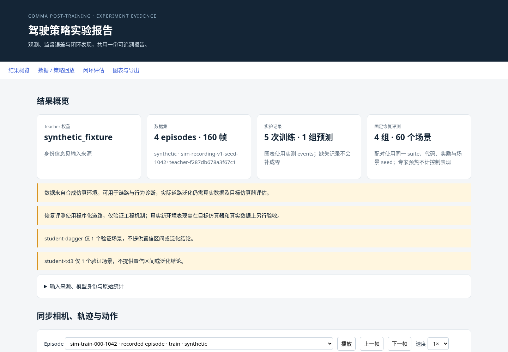
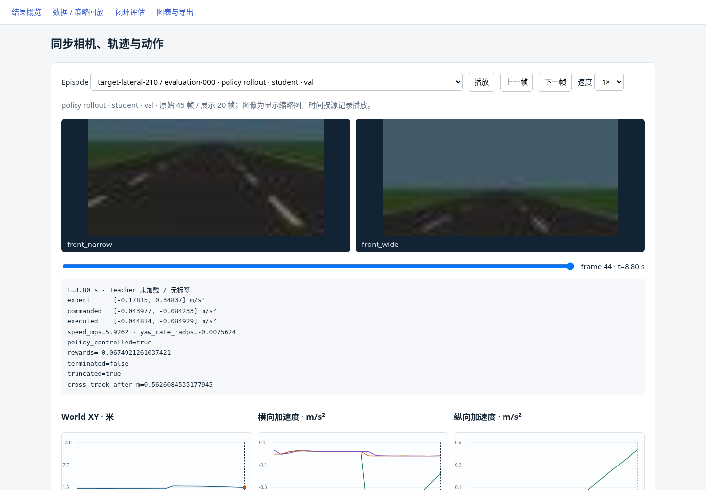
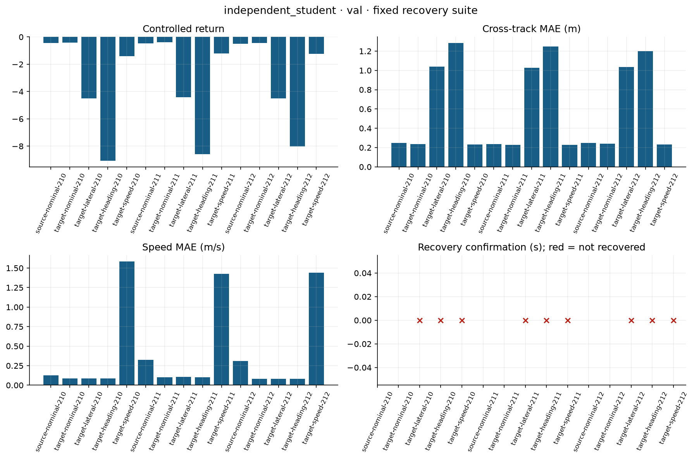

# 新环境适配框架：云端工程验收

日期：2026-11-09。使用 CPU、程序化道路和 `synthetic_fixture` ONNX。
本次没有官方模型权重或真实新环境数据，不提供官方 GPU/真实驾驶收益结论。
完整路线与真实实验命令见 [技术路线](../../adaptation-roadmap.md)。

## 实际执行

- 两套源/目标合成域，各 4 routes×40 帧；5 Hz、独立双相机，目标域为 dusk+1 步执行延迟。
- 生成 Teacher 形状的合成缓存，组合源/目标清单；来源检查正确拒绝将 fixture 当成官方缓存。
- 空间 CNN/GRU Student：4 帧历史、32×64 图像、2×4 网格；蒸馏 16 步、带源域回放的目标 SFT 16 步。
- 独立 Student 推理 37 帧，不加载 ONNX；其中 15 帧具有 Teacher 对照，公平 MAE 使用共同标签。
- DAgger / TD3 各 80 交互步、73 次 learner update。TD3 先预热 Critic 8 次，实际更新 Actor 32 次。
- 三组 Student 和一组合成 Teacher 各运行 15 个固定场景，共 60 个 episode；正常源/目标域及横向/航向/速度扰动各 3 seeds。
- 此次工程 suite 为 45 步（9 秒），25 步专家预热后由策略控制；正式配置为 150 步。
- Student/world 结构审计通过；world 报告仍明确 `official_4b_training_supported=false`。

训练数据和 fixture 只是验证参数更新、接口和统计逻辑。源域/目标域训练的损失权重不同，
不能将两次 loss 直接相减当作适配收益。

## 短预算评测没有通过模型准入

| 策略 | 15 场景平均控制回报 | 平均横向 MAE / m | 9 条扰动恢复率 | 配对准入 |
| --- | ---: | ---: | ---: | --- |
| Student SFT anchor | -3.08244 | 0.60341 | 0% | 对照 |
| DAgger | -1.50806 | 0.36943 | 0% | 失败：部分目标场景速度误差退化，恢复率不足 |
| Residual TD3 | -3.03982 | 0.59741 | 0% | 失败：恢复率不足，改善未达到预设门槛 |

三组 Student 均无真实终止，但这不等于完成扰动恢复。
DAgger 的平均回报/横向指标改善，仍不能掩盖速度误差和恢复失败。
真实原因需要更充分的数据、专家/奖励诊断和训练预算实验，不能仅归因为跑得短。

`compare-benchmarks` CLI 实测返回 1，保留 JSON，`checks` 为 JSON 布尔值；未修改任何 anchor 权重。
这些是工程示例，不构成对真实算法优劣的研究结论。

## 验证与展示

- `pytest -q`：142 项通过，含旧功能回归、空间视觉更新、来源保护、SFT 续训、独立预测、在线重载、恢复和数据合同。
- Ruff 检查及格式检查通过；wheel 离线构建成功；固定上游 submodule 元数据校验通过。
- 报告生成 22 张 PNG/SVG 图、CSV、6 段相机回放、12 行 benchmark 分组摘要。
- Chromium 桌面/移动端验收通过：切换 episode、滑块、播放、专家到策略控制区间，Student trace 不伪造 Teacher 曲线。
- 浏览器 0 页面错误、0 外部 HTTP 请求。

数值与环境版本：[summary.json](summary.json)；浏览器结果：[browser-validation.json](browser-validation.json)。
运行产物保留于云端 `outputs/acceptance/adaptation-20261109/`，数据和 checkpoint 按 `.gitignore` 不推入仓库。
可用 `pytest tests/test_adaptation.py tests/test_official_sim_pipeline.py -q` 重跑工程回归；
本地真实官方数据使用路线文档中的命令。

