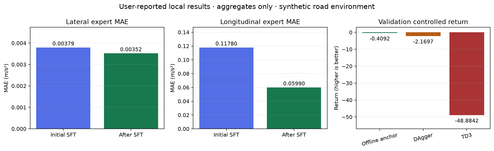

# 用户本地 v2 验收摘要与评估

来源是用户上传的本地测试文字摘要，原始 SHA256 与数字见
[user-summary.json](user-summary.json)。本目录没有逐帧原始日志、图像或 checkpoint；
图表只展示用户提供的汇总数字，不绘制未提供的训练曲线、延迟分布或轨迹。

[SVG 图](results-summary.svg) 可下载编辑。横纵向误差分别使用自己的尺度；
回报越大越好，离线改善与闭环退化分别展示。

- 官方 v2：60 帧、35 warmed、完整重放一致，CUDA profile；warmed P50/P95/P99 为 8.56/9.41/9.80 ms。
  这更新了 [11 月 6 日两帧记录](../local-rtx3090-20261106/README.md) 的初步状态。
- 离线残差：横向 MAE 约降 7.1%、纵向约降 49.2%，当前 val Gate 2 通过。
- DAgger 控制回报退化 1.7605；TD3 退化 48.4750。预算较短，但原因不能仅凭摘要确定。
- 116 项本地测试通过是用户报告的结果，与本次云端新增可视化测试的数量分别记录。
- Ruff 已由用户补装；真实驾驶数据和更可信的仿真动力学仍待接入。

下一步直接读取本地原始产物生成交互报告，必要时重评估固定策略并记录 trace。
完整命令、判读方法和诊断优先级见 [可视化与评估指南](../../visualization-and-evaluation.md)。
