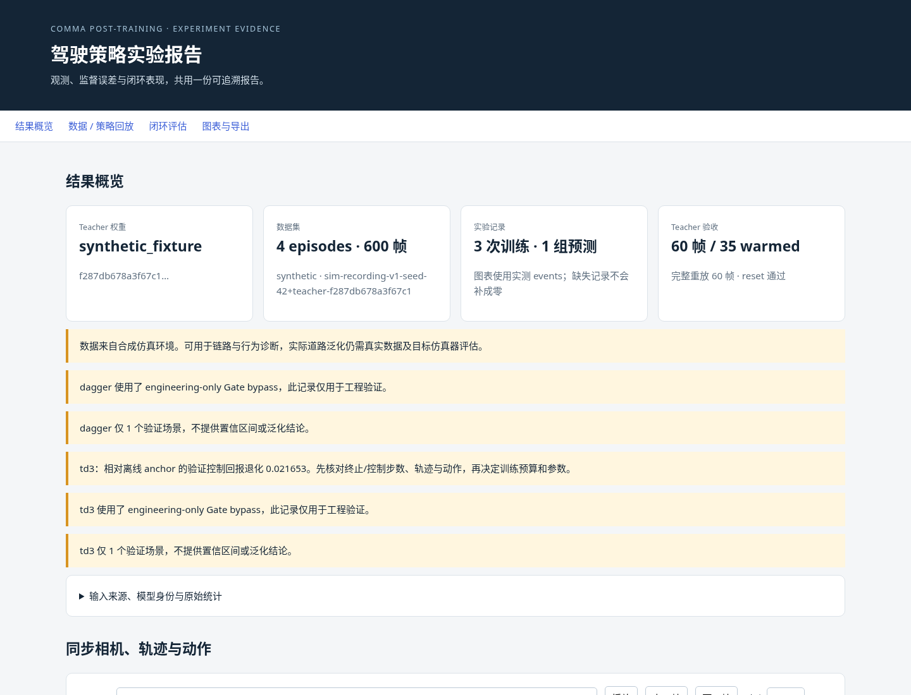
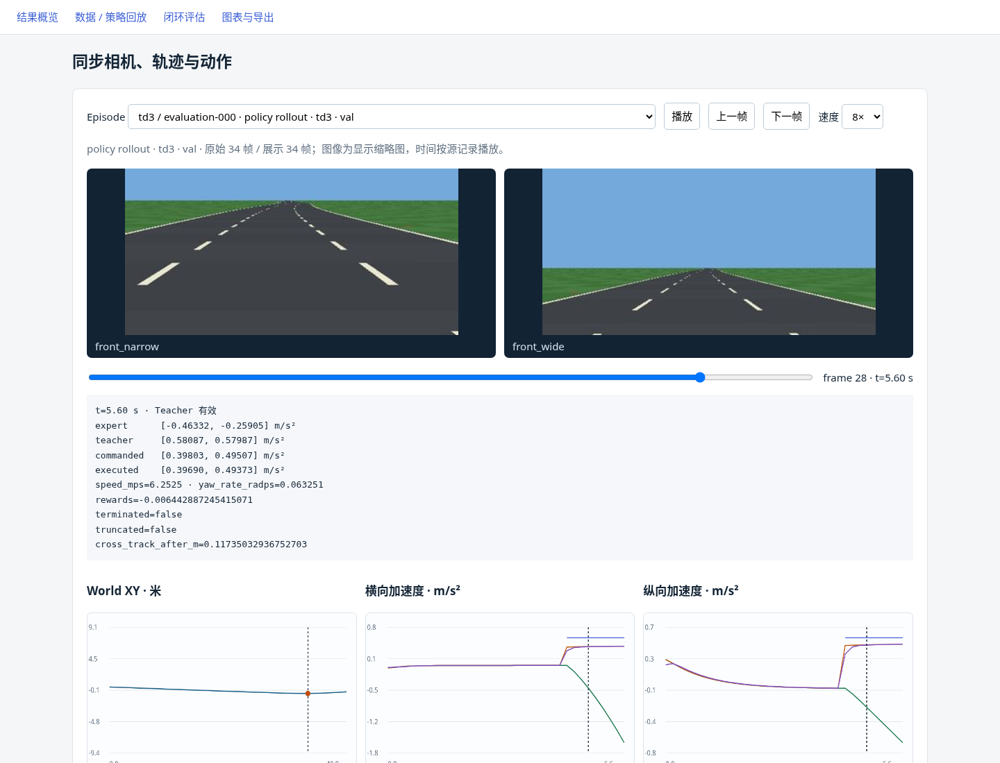

# 可视化功能验收：2026-11-09

本轮实现离线报告、独立 PNG/SVG、CSV/GIF 和可选的策略评估 trace。
当前云环境为 CPU，使用现有 `synthetic_fixture` ONNX 与内置合成道路数据验证；
没有重跑用户本地 GPU 实验。用户真实官方模型的报告摘要见
[本地结果分析](../local-rtx3090-20261109/README.md)。

- 完整 126 项 pytest 通过；其中新增 11 项覆盖 metadata 换行、trace 不改变 rollout、
  trace 到报告、相机/时间/预测对齐、mask、输入只读、缺失日志和退化判读。
- 用 4 条各 150 帧 episode、Teacher 缓存、SFT、DAgger/TD3 日志和四组实际评估 trace，
  生成 8 段回放、20 张 Matplotlib 图表、完整 CSV 与抽样 GIF。
- trace 验证相同 seed 下记录前后逐 episode 结果不变，专家/命令/实际动作和 pose 与环境重放一致；
  Teacher warmup 仍为 25 帧，最终截断与真实终止分别保留。
- Chromium 实际检查相机解码、滑块、上一/下一帧、切换数据/策略、播放/暂停及 8× 播放。
  页面载入后切断网络仍可回放；没有外部 HTTP 请求或未处理 JS 错误。
- 1440 像素桌面与 390 像素移动 viewport 通过，无横向溢出。云端浏览器限制 file URL，
  测试通过本地 HTTP 完成；报告不依赖外部服务。
- Ruff、格式、whitespace、锁文件、wheel/sdist、Markdown 链接及上游源码检查通过。
  wheel 包含 HTML 模板；未打包模型权重、实验数据或 checkpoints。

浏览器记录见 [browser-validation.json](browser-validation.json)。
下面截图来自**云端合成工程示例**，不是用户本地驾驶图像或官方权重的效果记录。

完整工作区产物保留在忽略目录 `outputs/visual-report-release-20261109/`，
包含 index.html、数值汇总、20 组 PNG/SVG、CSV、GIF。
复现命令与各指标的判读见 [使用指南](../../visualization-and-evaluation.md)。
