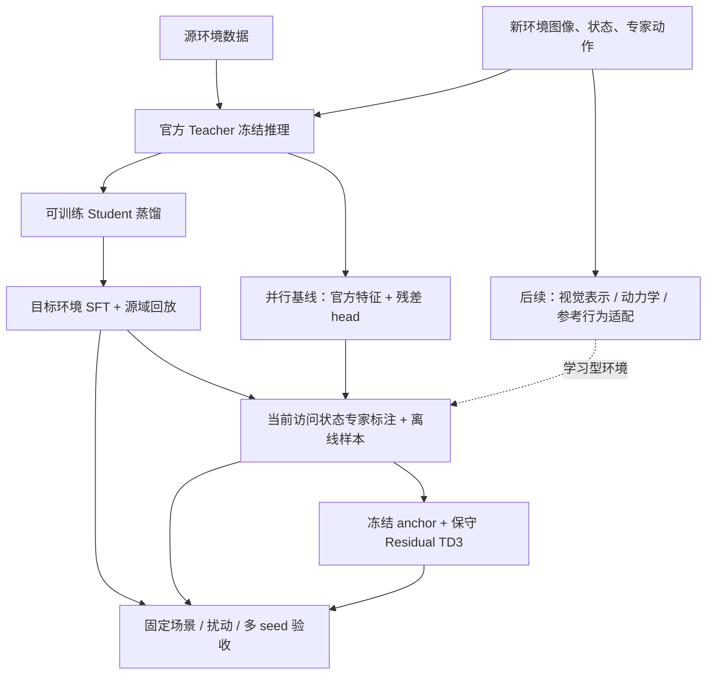

# 新环境驾驶策略适配：监督学习 → 闭环纠错 → 世界模型

目标：用新环境的数据学习合理驾驶动作，再利用闭环交互纠正策略访问状态上的误差，
最后在资源允许时适配视觉、动力学与参考驾驶行为的世界模型。

本路线首先落实可训练策略和可检验的恢复基准。原有官方 ONNX、残差 SFT 和在线 runner 继续保留。
官方 4B 世界模型训练不是前两个阶段的前置条件。

本轮实际执行结果、性能准入失败原因和报告截图见 [云端工程验收](acceptance/adaptation-20261109/README.md)。

## 1. 当前起点与缺口

已有：官方 Teacher 真实权重推理、特征缓存、残差 SFT、DAgger/TD3、episode 合同和可视化。
用户本地摘要表明 SFT val 改善，短预算 DAgger/TD3 回报退化。

关键缺口：

1. 冻结 Teacher 的 head 无法更新视觉表示；新环境有明显视觉变化时需要可训练 Student。
2. 轻量策略原来的全局平均池化丢失较多空间结构，需要可配置空间网格。
3. 尚缺直接读取图像的独立 Student 预测与模型来源记录。
4. 普通 seed 评估不能测出偏离后的恢复能力；初始扰动还可能被 warmup 专家提前修复。
5. 当前 TD3 缺少可选的 Critic 预热及专家/平滑正则，极短预算容易由不可靠 Critic 推动 actor。
6. 需要配对的固定 benchmark 和候选模型准入，避免把训练完成当成性能通过。

## 2. 总体架构



## 3. 分阶段技术路线

### A0 数据与环境：先建立可复现问题

采集字段、时序/标定、专家来源和首批数据验收见 [目标环境数据需求与交付规范](target-environment-data-requirements.md)。

数据统一为 comma-episodes-v1，动作单位 m/s²、FRD 坐标，明确 expert/commanded/executed。
按真实 route/session 和场景隔离 train/val/test；源域与目标域都保留固定评估集合。
Teacher 仍按 5 Hz，保留实际相机标定。原始 steer/throttle 由 adapter 转换，不直接当加速度。

工程环境支持 clear/dusk/fog 的合成外观、执行延迟和受控扰动，用于验证适配机制。
这些是程序化道路，不能当作真实天气/交通 benchmark；MetaDrive/CARLA/自有平台后续通过接口接入。

验收：独立双视角、相同 seed 重放、动作改变观测、专家响应扰动、完整元数据与无 route 泄漏。

### A1 监督学习：两条互补基线

**官方残差**：固定视觉表示，更新约 3.85 万参数 head。用于低成本行为校正与官方参照。

**可训练 Student**：保留空间网格的 CNN + GRU；先用官方 Teacher 标签和专家动作蒸馏，
再在新环境数据上 warm-start SFT。它的视觉编码器可更新，推理不依赖官方 ONNX。
本轮 Student 是本项目研究实现，不称为上游 convnext_pico/causal Transformer 原样复现。

```text
L = λ_BC * MSE(policy, expert) + λ_KD * MSE(policy, Teacher)
```

目标域优先可信专家监督；Teacher 在新域可能有偏差，不把它自动当真值。
保留 source 数据/离线比例防止遗忘；若源域与目标域的 preprocessing 合同不同，先显式标准化。
原生 domain_mix 是 real/sim/synthetic 的采样比例，不等于自动识别 source/target。

验收：target val 逐 route/逐轴改善，source val 无明显退化；样本数量、Teacher hash、初始化和数据版本可追溯。
Student 必须用真实官方缓存才可称为官方蒸馏；合成 ONNX 测试独立标注。

### B1 闭环纠错：先做 DAgger

使用 SFT checkpoint 初始化，在当前策略实际访问状态查询独立专家。
采用较小 learning_rate、较高 offline_fraction 起步，再逐项消融；保留行为策略版本、样本来源和 replay 容量。
不使用原录像同序号动作替代偏离状态的专家标签。

验收：固定 lateral/heading/speed 扰动后的恢复率、恢复时间、偏差与终止数，
同时对照继续离线 SFT，保持数据/交互/计算预算可比。

### B2 长期表现：保守 Residual TD3

冻结官方+离线 head 或 Student 作为 anchor。新增 actor 先零初始化，修正范围和探索噪声较小。
可选先只训练 Critic，再启用 Actor；Actor 可加入专家 BC 与命令变化率正则。
这些是显式可配置的 TD3 扩展，默认关闭以保留原算法行为，不能把它们隐含称为官方训练方法。

Critic 使用最终命令，actual acceleration 单独保存；next base 来自下一观测，terminated 与 truncated 分开 bootstrap。
Actor 更新次数单独报告，不能把只有 Critic 更新的运行称为已完成 Actor 优化。

验收：同 seed 配对比较 SFT/DAgger/TD3，记录回报、控制步数、偏差、实际 jerk、终止与恢复。
候选模型只有通过预设 val 门槛后才进入下一轮使用，失败时保留 anchor；test 用于最终报告。

### C 世界模型：资源就绪后分模块适配

1. 视觉表示：目标域图像的 VAE/encoder/decoder，检查重建、下游观测一致性和编码器版本。
2. 动力学：历史图像/latent、状态和实际动作条件预测未来；先做单步，再做短/长 rollout。
3. 参考行为：独立监督 expert action / plan；区分专家轨迹、实际轨迹和 Teacher 建议。
4. 策略使用：核对动作响应、reset、误差积累和场景偏差后，再接入 DAgger/RL。

优先冻结已验证模块逐项适配，最后再考虑联合训练。4B 的训练检查点、精度/算子和 GPU 兼容性需要另行验收。
本轮提供数据就绪审计；不下载或宣称已训练官方 4B。

## 4. 本轮实现与验收范围

- 具有空间信息的 Student 配置、严格 Teacher 来源选项、离线预测。
- 合成域变化、动作延迟和 warmup 后的受控状态扰动。
- 固定多 seed suite、恢复/平滑指标、配对模型比较与 val 准入。
- 可选 Critic 预热、专家正则、平滑正则和 Actor 更新计数。
- Student/世界模型数据就绪审计，以及接入现有报告的结果。

云端使用 CPU、程序化数据和明确的 synthetic_fixture ONNX 验证工程链路。
实际新环境收益需用户的真实数据和官方权重实验确认；不能通过 fixture 或调低门槛预填成功结论。

## 5. 推荐执行顺序

固定现有官方 Teacher 与 SFT anchor → 数据审计 → 源域蒸馏 → 目标域 SFT → 开环对照 →
固定恢复 benchmark → DAgger → 配对准入 → 保守 TD3 → 配对准入 → 独立 test → 后续世界模型适配。

## 6. 三种“模型”要分别管理

| 模块 | 当前用途 | 本轮更新的参数 | 推理是否依赖官方 ONNX |
| --- | --- | --- | --- |
| 官方驾驶 Teacher | 已发布驾驶网络，提供动作和 512 维特征 | 不更新 | 是 |
| 官方特征残差策略 | 在官方特征、状态和上一实际动作上校正动作 | 小型残差 head；TD3 时再增加 actor | 是 |
| 本项目 Student | 多视角图像、状态和历史动作直接输出加速度 | SFT 可更新 CNN、GRU、动作头 | 否 |
| 官方 4B 世界模型 | 后续生成新环境的未来视觉和参考行为 | 本轮未适配 | 与驾驶 ONNX 是不同模型 |

因此“暂时不用 4B”不影响前两阶段。原生 CNN/GRU 的作用是可训练驾驶策略，
原生 AE/Flow 的作用是世界模型实验基线；它们都不等于完整复现上游驾驶 Student 或官方 4B。

官方残差的输入约为 `512 feature + 2 state + 2 past action + 2 official action`。
Student 则将每路 CNN 输出保留为 `4×8` 空间网格，融合后交给 GRU，而非全部平均成一个空间点。
两路摄像头共享视觉 encoder。新配置使用 4 帧历史、128×256 Student 图像、128 维 GRU。
官方 Teacher 的两路输入 RGB 仍为 256×512；Student 缩放不改变 Teacher 的标定和预处理。

监督阶段全部解冻 Student 是当前可行的起点。现有 CNN/GRU 没有实现 LoRA，
也没有把 ONNX 转成可训练 PyTorch 官方网络。若后续必须更新官方原始参数，需要另设架构/权重转换与数值等价验收任务。

## 7. 自有数据应该如何准备

先建立小型 pilot，再扩数据。最小工程集可沿用 2 train route、1 val、1 test，
每条 30 秒、5 Hz；4 条双视角 uint8 原始 RGB 约 0.47 GB，缓存还会引用这些源图像。
这只能验收程序。研究实验建议从 50–100 条独立片段起步，并覆盖不同路线、光照、速度、弯道和偏离程度。
样本量最终由目标场景覆盖和学习曲线决定，不能由某个固定条数保证泛化。

| 字段 | 语义与对齐要求 |
| --- | --- |
| `timestamps` | 单调递增秒；Teacher 路径显式 5 Hz，不能把 20 Hz 帧逐一当作 5 Hz |
| `images` / `image_paths` | 按 camera_names 排序；真实双视角；source-to-model 变换或已校准模型视角 |
| `ego_state` | 当前观测状态；现有适配配置为 speed_mps、yaw_rate_radps |
| `expert_actions` | 对当前观测应采取的独立参考命令，非策略自己预测的动作 |
| `commanded_actions` | 当前观测之后发送的最终命令 |
| `executed_actions` | 该命令之后区间内实际达到的加速度；下一帧才能进入 past_actions |
| `poses` | 观测时刻的连续位姿；世界模型/轨迹分析需要 |
| `valid` / `expert_valid` / `teacher_valid` | 缺失、无效和预热帧用 mask；不以 0 填充冒充标签 |
| `teacher_identity` | 官方版本、权重 hash、adapter 和特征维度；由缓存流程生成 |
| `route_id` / `scenario_id` | 按真实连续驾驶过程和场景隔离；同一路段改光照不能伪造为独立测试路线 |

坐标为 FRD：x 前、y 右、z 下；正横向加速度朝车辆右侧。
转向角、方向盘角、油门和刹车量均不能直接当成 `[a_lat,a_long]`。
若从运动学换算，可用 `a_lat≈v²·tan(road_wheel_angle)/wheelbase`，但必须校准转向比、符号和车辆参数；
`a_long` 可由同步、滤波后的速度差分或重力补偿 IMU 估计。
实际动作是系统响应，专家标签是希望执行的命令，两者不能因格式相同而互换。

自有数据接入仍使用 [episode 合同](training-data.md) 和 `import-npz`。
`record-sim` 的 dusk/fog 是合成颜色和距离混合，延迟是离散 FIFO；它们不模拟真实天气、交通参与者或完整轮胎动力学。
当前 benchmark 专用于这个程序化环境。接入 CARLA/MetaDrive/自有平台后，应另建平台适配器和对应评测 suite，
继续使用 `evaluate-official` / `evaluate-closed-loop`，再补该平台的几何诊断指标。

## 8. 本轮新增代码与配置

| 文件 | 职责 |
| --- | --- |
| [data_pipeline/audit.py](../src/comma_post_training/data_pipeline/audit.py) | Student 与世界模型数据就绪检查 |
| [data_pipeline/combine.py](../src/comma_post_training/data_pipeline/combine.py) | 组合源域/目标域的只读 episode 引用，拒绝重复 ID 和跨 split route |
| [driving_policy/model.py](../src/comma_post_training/driving_policy/model.py) | 可配置空间池化的视觉 Student；旧 checkpoint 默认 1×1 保持兼容 |
| [driving_policy/predict.py](../src/comma_post_training/driving_policy/predict.py) | 无 Teacher 的 Student 预测、逐 route/逐轴误差和可视化输入 |
| [simulator/recording.py](../src/comma_post_training/simulator/recording.py) | 合成外观、执行延迟、Student 历史窗口和预热后扰动 |
| [simulator/metrics.py](../src/comma_post_training/simulator/metrics.py) | 控制区间偏差、实际 jerk、连续恢复和终止判定 |
| [simulator/benchmark.py](../src/comma_post_training/simulator/benchmark.py) | 固定场景、配对评估、val 候选准入、CSV |
| [simulator/td3.py](../src/comma_post_training/simulator/td3.py) | 可选 Critic 预热、专家/平滑项和 actor_updates |
| [configs/adaptation/](../configs/adaptation/) | 官方残差与 Student 的 SFT/DAgger/TD3、源/目标域恢复 suite |
| [tests/test_adaptation.py](../tests/test_adaptation.py) | Student 适配、独立预测、恢复门槛、数据和在线回归 |

DAgger 的 Student 路径保持视觉 encoder 冻结，缓存访问状态的视觉特征并更新 GRU/动作头，
这是当前高效实现；视觉域适配先在 SFT 完成。需要在线更新视觉 encoder 时，必须把 replay 改为原始图像或可重编码引用，
不能继续使用旧 encoder 生成的缓存特征。

## 9. 按顺序执行的命令

以下从仓库根目录执行，沿用你已验证的 `.venv-gpu`；云端 CPU 可替换成 `.venv` 并设置 Teacher provider=cpu。
这些命令是实验操作手册，不代表本轮云端已经执行真实官方 GPU 训练。
所有数据/训练/预测/benchmark/report 输出使用新的空目录；重新运行选择新版本目录。

### 9.1 固定旧 anchor，再建立源域与目标域数据

先归档现有 SFT checkpoint、环境版本、Teacher inspect/smoke 和配置。
下面两套合成数据仅验证新链路；有自有数据后换成对应 manifest。

```bash
.venv-gpu/bin/comma-driving record-sim \
  --output-dir data/local/source-road --duration-s 30 --seed 42
.venv-gpu/bin/comma-driving record-sim \
  --output-dir data/local/target-road --duration-s 30 --seed 1042 \
  --env-kwargs configs/adaptation/target-road.json

.venv-gpu/bin/comma-teacher cache \
  --model models/big_driving_supercombo.onnx --provider cuda \
  --manifest data/local/source-road/manifest.json --output-dir data/local/source-teacher
.venv-gpu/bin/comma-teacher cache \
  --model models/big_driving_supercombo.onnx --provider cuda \
  --manifest data/local/target-road/manifest.json --output-dir data/local/target-teacher

.venv-gpu/bin/comma-driving audit-dataset \
  --manifest data/local/target-teacher/manifest.json --stage student \
  --require-official-teacher --output outputs/adaptation/target-data-audit.json
```

审计 `ready=false` 时 CLI 返回 1，JSON 保留原因；格式损坏等输入错误返回 2。
官方检查校验缓存记录的 pinned 来源；审计不会重新加载 1.76 GB 权重。
生成缓存时的实际文件 hash 验证仍由 `TeacherSession` 完成。

### 9.2 先完成官方残差目标域基线

```bash
.venv-gpu/bin/comma-driving train --config configs/adaptation/official-residual.toml
.venv-gpu/bin/comma-teacher predict-adapted \
  --model models/big_driving_supercombo.onnx --provider cuda \
  --manifest data/local/target-road/manifest.json \
  --checkpoint outputs/adaptation/official-target/best.pt --split val \
  --output-dir outputs/adaptation/official-target-val
.venv-gpu/bin/comma-teacher gate-residual \
  --metrics outputs/adaptation/official-target-val/metrics.json \
  --output outputs/adaptation/official-target-val/gate2.json
```

若要在原有 head 上继续 SFT，第一条增加 `--init-checkpoint <旧 head.pt>`，
保持 Teacher identity、head 维度和 residual_scale 一致；这是 warm-start，不是跨版本严格 resume。
源域也应运行一次 `predict-adapted --split val`，检查遗忘。
Gate 2 失败时先检查标签、标定、饱和率和数据覆盖。较大行为偏差若超过 head 的修正范围，
仅增加训练步数通常不能解决，应评估 Student 或经过独立验收的残差范围调整。

### 9.3 蒸馏可训练 Student，再做目标域 SFT

```bash
.venv-gpu/bin/comma-driving train --config configs/adaptation/student-distill.toml
.venv-gpu/bin/comma-driving train --config configs/adaptation/student-sft.toml

.venv-gpu/bin/comma-driving predict-policy \
  --manifest data/local/target-teacher/manifest.json \
  --checkpoint outputs/adaptation/student-target/best.pt --split val --device cuda \
  --output-dir outputs/adaptation/student-target-val
.venv-gpu/bin/comma-driving predict-policy \
  --manifest data/local/source-teacher/manifest.json \
  --checkpoint outputs/adaptation/student-target/best.pt --split val --device cuda \
  --output-dir outputs/adaptation/student-source-val
```

还要用 `student-source/best.pt` 在同一个 target val 上预测，得到适配前后对照。
`predict-policy` 支持原生离线/DAgger Student checkpoint，可以预测无专家标签的观测；
无专家标签时误差为空。它不加载 Teacher；若 manifest 含合法 Teacher 缓存，可离线画 Teacher 对照。
Student 的全部专家帧 MAE 和 Teacher 共同有效帧上的配对 MAE 分别记录，图表使用后者进行公平比较。
TD3 export 包含额外 actor，使用下面 benchmark 或 `evaluate-closed-loop`，不会静默丢掉 actor。

默认目标域 SFT 的 KD 权重为 0，避免让新域专家监督被有偏 Teacher 拉回。
可通过固定实验对比 KD=0/0.1，不根据 test 选择权重。

如果 source val 退化，组合两套缓存并另开一组带回放的 SFT：

```bash
.venv-gpu/bin/comma-driving combine-datasets \
  --manifest data/local/source-teacher/manifest.json \
  --manifest data/local/target-teacher/manifest.json \
  --output-dir data/local/source-target-teacher --revision source-target-v1
.venv-gpu/bin/comma-driving train --config configs/adaptation/student-sft.toml \
  --manifest data/local/source-target-teacher/manifest.json \
  --output-dir outputs/adaptation/student-target-replay
```

组合清单保存绝对 episode 引用，不复制数组或修改源文件；移动机器后需重建清单。
两套数据必须有相同输入/Teacher 合同和不同 episode ID。
默认按可用窗口均匀采样，不保证 source/target 各 50%；先以相近窗口量构造 pilot。
`domain_mix` 只区分 real/sim/synthetic，不能用它伪装 source/target 权重。

### 9.4 固定闭环基线，观察恢复能力

```bash
.venv-gpu/bin/comma-driving benchmark \
  --suite configs/adaptation/recovery-val.json \
  --official-config configs/adaptation/official-dagger.toml --official-only \
  --output-dir outputs/adaptation/benchmark-official
.venv-gpu/bin/comma-driving benchmark \
  --suite configs/adaptation/recovery-val.json \
  --official-config configs/adaptation/official-dagger.toml \
  --output-dir outputs/adaptation/benchmark-official-sft
.venv-gpu/bin/comma-driving benchmark \
  --suite configs/adaptation/recovery-val.json \
  --checkpoint outputs/adaptation/student-target/best.pt --device cuda \
  --output-dir outputs/adaptation/benchmark-student-sft --record-traces
```

suite 含 source nominal、target nominal、横向/航向/速度扰动，共 5 类×3 seeds=15 场景。
每场景 150 步即 30 秒，前 25 步统一由环境专家预热，step 25 完成后施加扰动，
策略从下一个区间开始面对偏离状态。Student 也接受相同预热，避免比较中混入控制区间差异。
test 使用独立 split、不同道路池及额外 seed 偏移，不能用 test 报告做模型准入。
官方 benchmark 一次运行复用已校验的 Teacher session，每个 episode 仍明确 reset。

### 9.5 先 DAgger，后保守 TD3

官方路径仍需 Gate 2：

```bash
.venv-gpu/bin/comma-driving train-official --config configs/adaptation/official-dagger.toml
.venv-gpu/bin/comma-driving train-official --config configs/adaptation/official-td3.toml
```

Student 路径：

```bash
.venv-gpu/bin/comma-driving train-closed-loop --config configs/adaptation/student-dagger.toml
.venv-gpu/bin/comma-driving train-closed-loop --config configs/adaptation/student-td3.toml
```

这两条是分开的实验。默认 TD3 从 SFT anchor 开始，方便等条件比较。
若选择已通过准入的 DAgger 为 anchor，显式改 `policy_checkpoint` 或官方 `init_checkpoint`，
并让 Gate 2 对应这个准确 head hash；不自动串联未经验证的 checkpoint。
若 SFT 使用 replay 版本，也需把后续配置中的路径改到实际选中的 checkpoint。

新 TD3 preset 的初始建议：20,000 交互步、64 batch、512 采集预热、500 次 Critic-only 更新，
额外残差 ±0.15 m/s²、探索标准差 0.03。它们是待验证的起点，不是保证收敛的参数。
以 events 中 `actor_updated` / 汇总 `actor_updates` 判断 Actor 是否实际训练；
仅跑几十步并停在 Critic 预热阶段不能验收 TD3 策略优化。

Actor 目标的显式扩展为：

```text
L_actor = -Q1(s, a_final)
        + residual_penalty * ||a_final - a_anchor||²
        + actor_bc_weight * ||a_final - a_expert_current_state||²
        + actor_smoothness_weight * ||(a_final - a_actual_previous)/dt||²
```

最后一项是相对上一实际动作的命令变化惩罚；实际 jerk 在独立评测中计算。
Critic-only 阶段更新 Critic 与其 target，不更新 actor；随后按 policy_delay 更新 actor 和两个 target。
默认新增三项配置为 0/0/0，保留旧 TD3 行为。在线 replay 保存当前访问状态专家标签、上一实际动作和真实间隔，
启用正则而缺少对应字段时直接拒绝，避免使用原回放同序号标签。

### 9.6 候选选择、独立 test 和可视化

```bash
.venv-gpu/bin/comma-driving benchmark \
  --suite configs/adaptation/recovery-val.json \
  --checkpoint outputs/adaptation/student-dagger/final.pt --device cuda \
  --output-dir outputs/adaptation/benchmark-student-dagger --record-traces
.venv-gpu/bin/comma-driving compare-benchmarks \
  --baseline outputs/adaptation/benchmark-student-sft/metrics.json \
  --candidate outputs/adaptation/benchmark-student-dagger/metrics.json \
  --output outputs/adaptation/student-dagger-promotion.json
```

TD3 将 checkpoint 改为 `student-td3/final.pt`；官方在线策略增加 `--official-config`，
并传入 `--checkpoint outputs/adaptation/official-dagger/final.pt` 或 TD3 final.pt。
比较各自 SFT anchor，保持完全相同 suite、代码指纹、奖励、有效场景、Teacher 来源和动作约束。

默认准入要求每类至少 3 seeds，不增加任何一类场景的终止数，
每类平均控制回报下降不超过 0.05，横向/速度误差不超过 `baseline×1.05+0.02`，
逐轴实际 jerk 不超过 `baseline×1.2+0.1`，扰动恢复率至少 80% 且不低于 baseline，
还要恢复率至少增加 5 个百分点或扰动横向误差至少降低 5%。
这是预设工程门槛，不是统计显著性结论。生产目标应提前制定符合真实场景风险的阈值和更多 seeds，
不要为了让失败实验通过而事后放宽。

恢复必须同时满足横向≤0.3 m、航向≤0.05 rad、速度误差≤0.5 m/s，连续 5 步。
`recovery_time_s` 是扰动后到连续满足被确认的时间；此后若终止，该条恢复作失败。
正常场景恢复率为空；没有恢复的场景不填“0 秒”。所有失败都保留，不只统计存活片段。
门槛不通过返回 1，保留 JSON；不覆盖权重、不自动把 final.pt 当新的 anchor。

通过 val 后再使用 `configs/adaptation/recovery-test.json` 在新的输出目录评测。
原始和适配后策略都要在相同 test suite 跑一次；test 不用于反复调参。

```bash
.venv-gpu/bin/comma-driving report \
  --manifest data/local/target-teacher/manifest.json \
  --run-dir outputs/adaptation/student-source \
  --run-dir outputs/adaptation/student-target \
  --run-dir outputs/adaptation/student-dagger \
  --prediction-dir outputs/adaptation/student-target-val \
  --benchmark-dir outputs/adaptation/benchmark-student-sft \
  --benchmark-dir outputs/adaptation/benchmark-student-dagger \
  --trace-dir outputs/adaptation/benchmark-student-sft/traces/target-lateral-210 \
  --trace-dir outputs/adaptation/benchmark-student-dagger/traces/target-lateral-210 \
  --output-dir outputs/reports/new-domain-adaptation
```

报告展示双相机、真实 rollout、训练曲线、逐 route 动作误差、固定场景回报/偏差/恢复图，
并导出 PNG/SVG/CSV。无 ONNX Student trace 不绘制虚构 Teacher 曲线。

## 10. 世界模型阶段的入口与交付

现在即可保存未来要用的数据，资源充足再开始训练：

```bash
.venv-gpu/bin/comma-driving audit-dataset \
  --manifest data/local/target-road/manifest.json --stage world \
  --history 4 --future-steps 10 --output outputs/adaptation/world-data-audit.json
```

world 审计要求可用未来窗口、位姿、实际/命令动作、标定和明确动作来源；
独立专家参考覆盖有效帧至少 80%，train/val/test 至少 2/1/1 条 route。
`calibration` 使用非空 `id`、按 camera_name 映射的 3×3 `intrinsics`，
以及合法 4×4 `T_vehicle_from_optical`（共享矩阵或逐相机映射）；仅写一个 calibration_id 不足以通过几何检查。
`label_provenance` 应分别解释 expert、commanded、executed 的生成方式。
`ready=true` 只表示结构就绪，仍需人工审核标定、运动方向、同步和参考标签质量。

后续独立任务拆分：

| 工作包 | 训练/适配对象 | 独立验收 |
| --- | --- | --- |
| C1 视觉 | VAE/encoder/decoder，先冻结策略 | 图像重建、车道/小物体细节、latent 版本一致性 |
| C2 运动 | 图像/latent + ego state + executed action 条件动力学 | 单步误差、多步漂移、改变动作确实改变未来、延迟响应正确 |
| C3 参考行为 | expert plan/action head | 独立专家开环误差、跨路线泛化；不把 Teacher 建议当真实驾驶动作 |
| C4 环境接入 | reset/step/anchor/mask/终止与 reward | 与真实/高保真环境的动作响应和恢复排序一致；限制模型误差利用 |
| C5 闭环优化 | 固定世界模型中的策略后训练 | 与未适配世界模型、真实仿真器、相同预算策略对照 |

先用原生 AE/Flow 验证数据接口不意味着官方 4B 训练支持已经完成。
真正适配官方 4B 还需可训练模型结构/检查点、量化路径处理、VAE、运动条件和 anchor 构造、
训练稳定性与资源预算的独立实现。RTX 3090 的低精度算子兼容性需要实际核实，不能仅按参数量估计可行性。
请使用独立环境、依赖与资源目录管理，避免改坏已验收的 Teacher CUDA 环境。

## 11. 实验顺序、预算与停止条件

| 顺序 | 建议工程周期 | 交付/停止条件 |
| --- | --- | --- |
| A0 | 1–3 天，取决于自有接口 | 数据审计、符号/时间曲线人工验收；失败先修数据 |
| A1 官方残差 | 1–2 天起 | target/source val 与 Gate 2；残差饱和或视觉盲区先定位 |
| A1 Student | 2–5 天起 | source 蒸馏、target SFT、独立推理、遗忘对照 |
| B0 恢复基准 | 1–2 天 | 固定 suite、baseline、失败回放，先确认专家能恢复 |
| B1 DAgger | 3–7 天起 | 相同 val suite 准入；未通过保留 SFT 并做失败分类 |
| B2 TD3 | B1 稳定后 | 充分 Actor 更新、多 seed、与 SFT/DAgger 配对；退化不继续串联 |
| C 世界模型 | 另排资源与任务 | 先完成 C1–C4 独立验证再用于策略优化 |

周期是接口开发和诊断的估计，训练时间按本地吞吐实际测量。
第一轮只改变一个变量：BC/KD → 加源域回放 → DAgger → TD3 的 Critic 预热 → 专家正则 → 平滑正则。
建议记录以下对照：官方原始动作、官方残差、source Student、target SFT、等更新步数继续离线 SFT、DAgger、Residual TD3。
每条记录带 seed、交互步数、专家查询数、梯度更新数、训练耗时和数据版本；不要拿 100 步 smoke 与正式收敛模型比较算法优劣。

下一步最有价值的交付是：**在真实目标数据和固定 held-out 场景上确认 SFT 收益，
随后证明 DAgger 相对 SFT 提高了扰动恢复能力。** 在这个证据出现前，4B 世界模型不是当前瓶颈。
