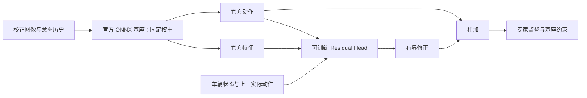

# 官方驾驶基座优先：Teacher 推理与冻结基座后训练

当前研究顺序调整为：**固定官方驾驶模型 → Teacher 推理 → 自有数据上的冻结基座残差训练**。
已实现仿真环境内的实时官方基座 DAgger / TD3；官方世界模型适配留待资源与数据就绪后开展。
阶段命令、数据合同和代码结构见 [P0–P4 操作手册](official-sim-post-training.md)。
此前的原生 CNN/GRU、AE、Flow 继续作为工程测试与算法基线，不能代替官方基座验收。

用户已选择：保留官方模型参数，训练附加策略/残差头。这里不会把 Student 蒸馏解释成
官方模型参数微调，也不会将本项目随机初始化策略称为 comma 基座。

## 当前交付与外部阻塞

| 项目 | 状态 |
| --- | --- |
| 官方权重身份 | 已从固定 Git 提交中的 LFS 指针取得 SHA256、大小 |
| 权重下载 | 用户本地已取得并通过 SHA 校验；云端仍无权重，媒体域名访问曾返回 403 |
| ONNX Runtime / RGB 依赖 | 已安装，支持 CPU 接口开发与测试 |
| 原始 ONNX 流式 adapter | 本地已报告 v2 的 60 帧完整重放与 CUDA profiling；主仓库补回 metadata 换行和 DLL 预加载兼容 |
| 相机/状态预处理 | 已实现显式标定 RGB 入口、YUV420 平面打包、5 Hz 队列与 reset |
| Teacher 缓存 | 已实现动作/特征/有效帧派生数据集，保留模型与预处理来源 |
| 冻结基座残差 SFT | 已实现，只有附加 head 参与优化 |
| 组合推理 | 已实现实时 Teacher + residual head，检查基座身份 |
| 仿真录制 | 独立双视角 pinhole、5 Hz、专家/实际动作、位姿、分组与诊断图 |
| 官方基座闭环 | 独立 train-official：DAgger / 冻结 SFT anchor 的 residual TD3，默认要求 Gate 2 |
| 现有验证 | 用户本地已报告 60 帧官方 smoke、500 个仿真标签、SFT 改善和闭环退化；原始日志未上传云端 |

用户本地的四份 GPU 日志已按 [验收记录](acceptance/local-rtx3090-20261106/README.md) 保存摘要与原始哈希。
11 月 6 日日志对应用户修复的 v1 adapter，之后的
[11 月 9 日本地摘要](acceptance/local-rtx3090-20261109/README.md) 已报告 v2 完整验收与初步后训练。
模型不需要上传 GitHub。后续重点与新增可视化命令见 [评估指南](visualization-and-evaluation.md)。

## 一、模型版本与证据

本阶段使用与固定社区 distill 版本兼容的官方 driving Teacher，而不是随 openpilot main
移动的 latest 模型：

```text
repository: commaai/openpilot
commit:     084747c75d2cbd23af65ab7a9e770bbd7b98bac9
artifact:   openpilot/selfdrive/modeld/models/big_driving_supercombo.onnx
sha256:     a501760a9d1d5fef0eab2b8c5d122d06124fc26dc8e0782e0aa94b82a208f0ff
size:       1,757,355,221 bytes（约 1.76 GB / 1.64 GiB）
```

[官方 LFS 指针](https://raw.githubusercontent.com/commaai/openpilot/084747c75d2cbd23af65ab7a9e770bbd7b98bac9/openpilot/selfdrive/modeld/models/big_driving_supercombo.onnx)
可以核验权重身份；它自身只有 135 字节，不能当作模型运行。
记录见 [模型清单](../configs/teacher/official-084747c.json)。运行时常量位于
`teacher/assets.py`，CLI 不接受任意模型冒充这个官方身份。

输入/输出合同按同一提交核对：

- [compile_modeld.py](https://github.com/commaai/openpilot/blob/084747c75d2cbd23af65ab7a9e770bbd7b98bac9/openpilot/selfdrive/modeld/compile_modeld.py)：图片打包、features/desire 队列、模型原始输入。
- [modeld.py](https://github.com/commaai/openpilot/blob/084747c75d2cbd23af65ab7a9e770bbd7b98bac9/openpilot/selfdrive/modeld/modeld.py)：desire 上升沿、直接 action 输出和车端平滑。
- [constants.py](https://github.com/commaai/openpilot/blob/084747c75d2cbd23af65ab7a9e770bbd7b98bac9/openpilot/selfdrive/modeld/constants.py)：20 Hz 运行、5 Hz 上下文与轨迹定义。
- [parse_model_outputs.py](https://github.com/commaai/openpilot/blob/084747c75d2cbd23af65ab7a9e770bbd7b98bac9/openpilot/selfdrive/modeld/parse_model_outputs.py)：plan 的均值/标准差排列。

`third_party/openpilot` 的系统研究快照仍是 `493ae5a…`；本阶段 runtime 不从该不同版本导入
输入常量或模型解析器。既有 distill 源码保持原样，也不是本阶段 runtime 的隐式依赖。

## 二、安装、下载与最小推理

在仓库根目录执行：

```bash
export UV_CACHE_DIR=/workspace/.cache/uv
export UV_SYSTEM_CERTS=true
uv sync --locked --extra teacher --python 3.12

# 网络就绪后下载 1.76 GB 权重；先校验大小与 SHA256，再发布到目标文件
uv run --locked --extra teacher comma-teacher fetch
uv run --locked --offline --extra teacher comma-teacher verify

# 检查实际 ONNX 输入 shape/dtype、输出 slices、provider、暖启动长度
uv run --locked --offline --extra teacher comma-teacher inspect

# 官方图在黑色 model-space RGB 上做流式计算，并检查 reset 可重复性
uv run --locked --offline --extra teacher comma-teacher smoke \
  --frames 2 --output outputs/official-teacher/smoke.json
```

默认模型位于 `models/openpilot-084747c/big_driving_supercombo.onnx`，所有命令可用 `--model`
指定已在其他机器取得的同一官方文件。不会因文件名相同而跳过 hash 校验。
下载失败不留下可被误加载的半成品，不自动替换成小模型或镜像权重。

`smoke` 只检查真实官方网络能否执行，输入仍是合成黑帧；两帧不会填满上下文。
它不能证明标定正确、驾驶质量可靠或与 modeld 的完整实时运行逐位一致。
真实驾驶验收还需下面的标定片段和参考输出对照。

当前 extra 安装的是 CPU ONNX Runtime。`--provider cuda` 只有在目标独立环境提供
CUDAExecutionProvider 时才可选择；不能靠改参数将 CPU wheel 变成 GPU runtime。
Teacher 和 PyTorch 残差头可以分别使用 CPU / GPU，缓存后残差训练本身无需加载 1.76 GB 基座。

## 三、Teacher 输入与数据要求

统一 [episode 合同](training-data.md) 不变，额外在每个 `episode.json` 写入 `teacher_rgb`。
模板见 [rgb-profile.example.json](../configs/teacher/rgb-profile.example.json)。
其中 homography 是 `null` 占位，必须用实际标定替换；程序不会静默使用单位矩阵。

两种模式：

| mode | 含义 |
| --- | --- |
| `source_to_model_homography` | 原始 RGB + 每个输入视角的 source→model 3×3 单应矩阵，显式 warp |
| `prewarped_model_rgb` | 图像已经在相应模型视角下校正；要求精确尺寸，不再 resize |

官方该模型通常要求两路 `256×512 RGB` 视图，转换为 `6×128×256` 的 YUV420，
再将前一帧和当前帧拼为 `1×12×128×256`。实际尺寸以 `inspect` 读取的图为准。
六个通道依次为 Y00、Y10、Y01、Y11、U、V；不额外套用通用 ImageNet 均值/方差。

`img` 与 `big_img` 是不同模型视角，即使来自同一个源摄像头，也要分别提供匹配的标定。
模板中 `source_to_model` 映射源像素到目标像素；官方 `get_warp_matrix` 返回的采样矩阵方向
不同，不能不加判断直接粘贴。预处理 ID、实际矩阵、calibration_id 都应版本化。

本 adapter 从 RGB 做 OpenCV warp 和 I420 转换，像素处理路线对应 distill 的 RGB loader。
车端 camerad 使用 NV12、不同插值和硬件内核，二者尚未做真实帧数值对照。
这个差别必须在验收中量化，不能声称完整复现了车端图像流水线。

时序规定：

- 输入已显式采样为连续 **5 Hz**；更快数据直接报错，时间间断和 valid=false 触发 reset。
- Teacher 自身保留图片对、feature history、desire history；不跨 episode 或断帧传播状态。
- `desire_mode=none` 显式表示没有 lane-change 等意图；`array` 模式读取 `teacher_desire.npy [N,8]`。
- desire 输入是 one-hot 状态，runtime 转成上升沿脉冲；不能把持续意图反复当作新脉冲。
- `traffic_convention=[1,0]` 表示右侧通行，`[0,1]` 表示左侧通行；需要按数据真实地点填写。
- `action_t_s=[lat_delay,long_delay]` 为实际秒数，模板 0.2 只是示例。可通过数组
  `teacher_traffic.npy [N,2]`、`teacher_action_t.npy [N,2]` 提供逐帧值。
- 前面的零历史帧仍可推理，但不会成为有效训练标签。暖启动长度由实际 graph 队列推导，
  该版本预期屏蔽最初 25 帧；每段应明显长于约 5 秒。

本阶段直接缓存网络的 `[a_lat,a_long] m/s²`，不是 modeld 平滑后的 desiredAcceleration/
desiredCurvature。专家目标的时间和单位必须与此一致；不要直接用方向盘角/油门/刹车监督。

## 四、生成官方特征与动作缓存

准备包含 train/val/test 且 route 隔离的数据，并给每段补齐上面的 `teacher_rgb`：

```bash
uv run --locked --offline --extra teacher comma-teacher cache \
  --manifest data/local/own-v1/manifest.json \
  --output-dir data/local/own-teacher
uv run --locked --offline --extra teacher comma-driving validate-dataset \
  data/local/own-teacher/manifest.json
```

生成新的派生 manifest，不修改原始数据：

```text
teacher_actions.npy    [N,2]，官方基座输出
teacher_features.npy   [N,F]，hidden_state / feature queue 对应的官方特征
teacher_valid.npy      [N]，屏蔽暖启动、无效与间断帧
episode.json           原始数组引用 + Teacher 身份/预处理 hash/provider/有效帧数
```

Teacher 是固定推理模型，对各 split 产生标签；残差训练与模型选择仍严格分别使用 train / val，
最终评价使用 test。缓存中的 feature_dim、模型 SHA、adapter_version 必须一致。
特征和动作是同一次访问状态的输出，不能分别打乱或按长度拼接。
派生缓存保留原始数组绝对引用，因此搬迁时还需要迁移来源并更新数据版本。

## 五、冻结官方模型，训练残差头



`official_residual` 与原生 `policy` 是不同任务。当前 residual head 使用官方当前特征、
车辆状态、上一实际动作和官方 base action；两层 MLP 输出有界修正：

```text
a_final = a_official + residual_scale * tanh(head(context))
loss = bc_weight * MSE(a_final, a_expert)
     + kd_weight * MSE(a_final, a_official)
```

最后一层零初始化，因此开始时严格恢复原官方动作。默认逐轴修正范围为 ±0.5 m/s²，
可在配置里修改。KD 是偏离基座的约束，不是“重新蒸馏成另一模型”；必须有 BC 专家监督。
官方模型的全部参数都在 ONNX 文件中，既不属于 optimizer，也不会被梯度更新。

```bash
uv run --locked --offline --extra teacher comma-driving train \
  --config configs/training/official_residual.toml \
  --manifest data/local/own-teacher/manifest.json \
  --output-dir outputs/official-residual

uv run --locked --offline --extra teacher comma-driving evaluate-checkpoint \
  --checkpoint outputs/official-residual/best.pt --split test
```

第二条命令使用已缓存的官方特征评估。checkpoint 只保存 residual head 及基座身份，
不会再次打包 1.76 GB 权重。数据版本、Teacher 身份变化都不能当作精确续训；可在兼容条件下
用 `--init-checkpoint` 开新的适配实验。正常 `--resume` 规则见原生训练说明。

这一步实现**离线监督残差后训练**。实时官方基座另通过 `teacher/policy.py` 和
`simulator/official_runner.py` 接入仿真 DAgger/TD3，命令见 [P3](official-sim-post-training.md)。
在线精确续训尚未实现；官方原参数始终冻结。官方世界模型适配仍属后续阶段。

## 六、真实组合推理与评价

```bash
uv run --locked --offline --extra teacher comma-teacher predict-adapted \
  --manifest data/local/own-v1/manifest.json \
  --checkpoint outputs/official-residual/best.pt \
  --split test --output-dir outputs/official-residual-test
```

这里会重新执行官方 Teacher，用实时得到的特征和 base action 加载残差头，
而不是直接复用缓存来假装完成官方组合推理。基座 SHA 和 adapter 身份不匹配会立即停止。
输出逐帧 JSONL、原基座/适配后每轴 MAE、有效样本数与模型/数据来源；没有 expert 时只输出预测。
预测是网络加速度，尚不包含完整 modeld 的曲率转换、平滑、消息和控制接口。

## 七、后续实际验收顺序

1. 下载真实权重，通过 SHA256 和 size；`inspect` 合同与固定源码一致。
2. 官方权重黑帧 smoke：原图执行、输出有限、reset 重复；记录 CPU/GPU 和延迟。
3. 取得两段以上可信标定驾驶样本，与同版本参考输入/输出逐项比较，检查 RGB/NV12 误差。
4. 自有数据缓存后，先小样本过拟合、保存重载，再比较 held-out route 上官方基座与残差策略。
5. 固定多个 seed/场景和修正范围，检查各场景收益及退化；不只依据训练 loss 判断改善。
6. 算力与数据支持后，再接入官方 VAE/世界模型并开展闭环后训练。

用户本地最新摘要已报告完成 v2 warmup smoke、仿真 episode、P2 对照以及短预算闭环。
下一步重点是可视化诊断闭环退化、扩大独立场景；可信标定驾驶片段仍需完成第 3 步。

## 历史云端验证记录（2026-11-06）

在无 GPU 的当前云实例安装并使用 ONNX 1.23.2、ONNX Runtime 1.31.1 CPU、OpenCV 4.14。
全部 86 项测试通过，其中 11 项为新增 Teacher 接口与残差训练集成测试。
这些测试用本地生成、显式标记 `synthetic_fixture` 的微型 ONNX 图，未使用官方权重。
测试覆盖与原始图直接 ORT 调用的一致性、YUV 平面顺序、历史状态/reset、desire 脉冲、
暖启动和无效帧屏蔽、模型哈希、缓存不覆盖源数据、残差限幅、零修正恢复基座、
完整分段续训逐参数一致，以及实时 Teacher + residual 的预测和身份不匹配拒绝。

CLI 拒绝将微型测试图当作官方模型。依赖、CLI 入口、Ruff、包构建、源码版本与链接检查
分别执行；它们不替代真实官方网络的验收。当时云端官方权重执行次数为 0，真实驾驶数据测试为 0。
当前 runtime 网络策略尚未包含媒体域名，已保存的网络草稿没有改变该事实。

## 当前验证（2026-11-09）

115 项测试通过，包括 23 项 Teacher 测试与 17 项新增仿真/在线集成测试。
合成 ONNX 重现真实输入尺寸、FP16 controls、4 通道 raw action、512 维特征和尾部 padding。
测试覆盖两路独立图像、动作改变观测、5 Hz 录制与最终观测、源数据不修改、零残差等于基座、
逐 route 指标、Gate 2、DAgger 当前状态专家标签、Teacher 不跨 episode、TD3 正确 next base、
冻结离线 head 以及组合策略重载。当前云端仍未执行官方权重或 CUDA 训练。
