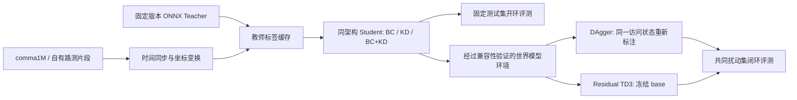

# openpilot 驾驶策略后训练：研究分析

目标：**蒸馏可训练的驾驶 Student → 建立 BC/KD 基线 → 世界模型内 DAgger → 冻结基础策略的 Residual TD3**。
本分析结合用户提供的参考对话，逐项核查了 GitHub 源码。模型卡和博客域名的当前请求返回代理
403，因此下文区分已核实的代码事实、拟开展的实验和仍需验证的资产。

## 核查结果与需要修正之处

| 项目 | 核查结果 | 对实验的影响 |
| --- | --- | --- |
| `openpilot.distill` | 个人账号发布的研究项目；README 有 localization → distillation → DAgger-style post-training 三步 | 优先作为复现入口，不称为 comma.ai 完整官方训练流水线 |
| 教师版本 | 上游固定 openpilot `084747c…`，使用 `big_driving_supercombo.onnx` | 模型、预处理、输出 parser 必须来自同一版本；不能直接混用最新 master |
| 数据文件 | `supervised/dataset.py` 读取 `frame_info.safetensors`、`localizer.safetensors`、`fcamera.hevc`，可选 `ecamera.hevc` | 参考对话中遗漏的 `frame_info.safetensors` 必须补齐 |
| 动作标签 | 上游将定位状态变换、插值为 plan，再按 `action_t` 得到 `[曲率×速度², 纵向加速度]` | 不能直接把定位 tensor 或方向盘角当作训练动作 |
| 监督损失 | 上游同时监督图像、pose、plan、action，并蒸馏教师多个输出及 hidden state | 本仓库 action-only BC/KD 是独立消融基线，不声称复现完整上游损失 |
| `rl/train.py` | 冻结共享模型、更新 `on_policy_temporal`，使用 rollout 世界模型 plan 构造的动作做 MSE | 属于上游声明的 DAgger-style 更新；该脚本没有 TD3 的双 Critic 和 Bellman 更新 |
| GPU 要求 | 监督入口无条件选择 CUDA；视频解码依赖 PyNvVideoCodec；世界模型 server 拒绝 CPU | 当前 CPU 云实例不能直接运行完整上游训练 |
| 依赖版本 | 上游 Python `>=3.12.3,<3.13`、Torch `2.13.0`；当前工程为 CPU Torch `2.15.0+cpu` | 上游应使用独立环境及其锁文件，避免覆盖当前 CPU 环境 |
| 世界模型 | 上游引用 `model.fp8_nvfp4.torchpackage`，另需 VAE `commaai/vit-ae-2x-f8c32` | 需同时固定两套资产；3090 Ti 的算子、显存和解码兼容性尚未验证 |
| 数据规模 | 未能直接查询 comma1M 模型卡或文件列表 | 不把参考对话的 4,216 段/550GB 当成已复核事实；先取 2 段做格式检查 |
| 0.11.2 TD3 报告 | `blog.comma.ai/0112release/` 当前不可访问 | Residual TD3 先作为明确的研究变体设计，严格复现声明须待原始报告核对 |

版本、引用路径和未解析的 revision 记录在
[upstream.lock.json](../configs/driving/upstream.lock.json)。其中的 null 表示未取得，不能当作有效校验值。

## 实验路线

第一个真实实验的边界是：**同一 Student、相同 route 划分和预算，比较 BC、KD、BC+KD**。
先原样复现上游多任务训练，确认数据与教师接口，再做 action-only 消融。辅助损失、编码器初始化、
图像历史长度和采样频率应在对照组保持一致。实验登记见
[experiments.toml](../configs/driving/experiments.toml)，它尚不是训练器配置。

进入 DAgger 前，先证明世界模型会响应动作、reset 可重复、上下文/锚定帧来自正确的数据划分。
对策略访问的新状态重新查询标签；原始回放动作不能不经变换地充当偏离状态的专家动作。
世界模型 plan 是模型生成的监督源，需要与真实定位/可信参考进行校准，不能当成无误差真值。

Residual TD3 使用研究形式 `a = clip(a_base + scale * tanh(residual), low, high)`。
两个分量均须使用明确的加速度单位，`scale/low/high` 由数据及控制约束确定。基础策略与编码器
冻结；双 Critic、target smoothing、延迟 Actor 更新、终止/截断语义、Actor 平滑项分别验证。
奖励函数及其权重单独版本化，不将参考对话的建议奖励冒充官方实现。

## 评测原则

开环先报告横/纵向加速度 MAE、位置轨迹 ADE/FDE 和 jerk；预测与参考必须已对齐，且来自同一坐标系。
action 时间网格与未来轨迹时间网格分别记录，不能把 openpilot 非均匀的 33 点轨迹当成等间隔动作。
ADE/FDE 只在显式提供的、相同时间网格的轨迹上计算，不会凭两维加速度自动还原轨迹。

`jerk = Δacceleration / Δtime`，单位 `m/s³`。参考对话最后的“加速度二阶差分”计算的是 snap，
不是 jerk。当前工具报告时间加权的单段 jerk RMS，再对段做宏平均，不跨片段差分。

闭环单独统计扰动恢复率、跟踪误差、越界/碰撞/动作超限率、失败和超时。成功率的分母包含失败
episode，不能只报告成功样本。延迟、峰值显存和回放速度须在目标 GPU 上实测；当前工具不生成
这些尚未测得的数值。合成 fixture 的结果用于验证实现，不代表驾驶质量或闭环改善。

## 当前资源与下一步

当前云实例有 CPU、约 33GiB RAM、约 60GB 可用磁盘，无 CUDA GPU。用户给出的目标显卡为
RTX 3090 Ti 24GB；首先在该设备上做解码、ORT Teacher、Student 单步及峰值显存测试，不能先承诺
默认上游配置适配 24GB。4B 世界模型另做兼容性验证，必要时使用经过验证的远端 GPU server；
MetaDrive 或轻量动力学可以验证接口，但其结果不能替代 comma 世界模型复现。

本次未下载真实数据或模型、未运行上游 GPU 训练。当前网络策略拒绝 `huggingface.co` 和
`blog.comma.ai`；教师下载还需要上游明确使用的 `media.githubusercontent.com`。
真实资产阶段先在环境设置中加入必要访问，重试后再依据实际重定向补齐目标域名。公开资产无需
预先申请密钥；只有确认 gated/private 访问才需要对应授权。网络或环境发布配置本次未修改。

先完成 [任务表](tasks/openpilot.md) 的 T01–T05，再开展三组监督实验。

## 已检查的源码

- [distill README](https://github.com/YassineYousfi/openpilot.distill/blob/215f33d4a860f380df4b4f4f075c6c9493f5c205/README.md)、[依赖](https://github.com/YassineYousfi/openpilot.distill/blob/215f33d4a860f380df4b4f4f075c6c9493f5c205/pyproject.toml)
- [数据与标签构造](https://github.com/YassineYousfi/openpilot.distill/blob/215f33d4a860f380df4b4f4f075c6c9493f5c205/supervised/dataset.py)、[监督训练](https://github.com/YassineYousfi/openpilot.distill/blob/215f33d4a860f380df4b4f4f075c6c9493f5c205/supervised/train.py)
- [上游监督入口](https://github.com/YassineYousfi/openpilot.distill/blob/215f33d4a860f380df4b4f4f075c6c9493f5c205/supervised/README.md)、[世界模型 server](https://github.com/YassineYousfi/openpilot.distill/blob/215f33d4a860f380df4b4f4f075c6c9493f5c205/rl/server.py)、[DAgger-style 训练](https://github.com/YassineYousfi/openpilot.distill/blob/215f33d4a860f380df4b4f4f075c6c9493f5c205/rl/train.py)
- [openpilot modeld](https://github.com/commaai/openpilot/blob/070de2aefc9474a1b1cd9938939259f5764da490/openpilot/selfdrive/modeld/modeld.py)、[MetaDrive 桥接](https://github.com/commaai/openpilot/blob/070de2aefc9474a1b1cd9938939259f5764da490/openpilot/tools/sim/README.md)、[日志](https://github.com/commaai/openpilot/blob/070de2aefc9474a1b1cd9938939259f5764da490/docs/concepts/logs.md)
