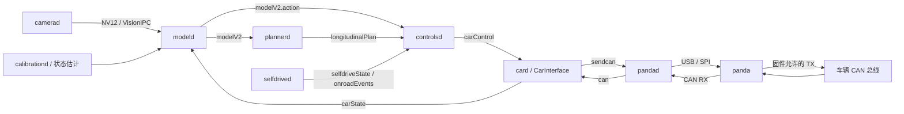

# 01 系统架构：从摄像头到车辆控制

阅读根目录：`third_party/openpilot/`。文中缩写路径均相对于该根；精确行号见
[源码地图](00_source_map.md)。

## 三个独立系统

| 系统 | 输入 | 核心计算 | 结果 | 当前可读代码 |
| --- | --- | --- | --- | --- |
| 世界模型研究 | 视频、标定、运动状态 | 压缩、条件动态预测 | 图像 latent、参考 plan | commaVQ 参考实现；distill 世界模型调用接口 |
| 策略训练 | 真实/生成观测、监督或 reward | BC/KD、DAgger、拟实现 TD3 | Student/策略 checkpoint | `openpilot.distill/supervised`、`rl` |
| 车端系统 | 摄像头、CAN、标定、状态 | 推理、规划、控制、车型编码、安全检查 | 允许的 CAN 帧 | openpilot + opendbc + panda |

车端通常不加载 4B 世界模型。训练中生成的图像也不是车端感知传感器的直接替代物。
三个系统通过明确的图像、时序状态、动作、标定和导出协议连接。

## 实际运行数据流

进程是并行的。`process_config.py` 注册进程及 onroad/offroad/硬件条件；管理器按条件维持进程，
不意味着先执行完整个 modeld 再执行 controlsd。`pandad` 是主机消息与硬件通信之间的桥，
因此 `card → panda` 的概念箭头应展开成 `sendcan → pandad → USB/SPI → firmware`。

## 核心目录与职责

| 路径 | 关键对象 | 重点读法 |
| --- | --- | --- |
| `openpilot/system/manager/process_config.py` | `procs` / `managed_processes` | 哪些进程在哪种运行条件下启用？ |
| `openpilot/cereal/messaging/__init__.py` | `SubMaster` / `PubMaster` | 消息更新时间、alive/frequency/valid 各是什么检查？ |
| `openpilot/cereal/log.capnp` | `ModelDataV2`、`DrivingModelData`、`ControlsState` | 模型、控制、运行状态的结构 |
| `openpilot/selfdrive/modeld/` | `ModelState`、`Parser` | 图像、运行产物、循环状态和输出解析 |
| `openpilot/selfdrive/controls/plannerd.py` | `main` | 按 `modelV2` 更新规划与驾驶辅助 |
| `openpilot/selfdrive/controls/controlsd.py` | `Controls` | 将目标和实时状态变成 actuators |
| `openpilot/selfdrive/car/card.py` | `Car` | CAN 解析、车型识别、`CI.update/apply` |
| `openpilot/selfdrive/selfdrived/` | `SelfdriveD` | 事件、enabled/active、接管和禁用状态 |
| `openpilot/selfdrive/pandad/` | Python 管理器和 C++ CAN 线程 | 设备状态、安全配置、发送时效性和 CAN IO |

注意 `CarControl` 等车型结构在 opendbc 的 `opendbc/car/car.capnp`，不是都在 openpilot 的
`log.capnp`。`openpilot/opendbc_repo` 是运行依赖；顶层 `third_party/opendbc` 是另一个阅读快照。

## 多速率控制

| 层级 | 本版本的时序依据 | 工程含义 |
| --- | --- | --- |
| 驾驶模型 | `MODEL_RUN_FREQ=20`、`DT_MDL` 与相机帧 | 约 50ms 更新一次目标 |
| 规划 | `plannerd` 的 SubMaster `poll='modelV2'` | 有新模型消息才更新 |
| controlsd | `Ratekeeper(100)` | 目标 10ms 控制周期，使用当时可用的状态和目标 |
| card | CAN receive 驱动，目标/预期约 100Hz | 不是视觉模型的同步函数调用 |
| CAN TX | 各车型 `CarController` 的 frame/counter 分频 | 不代表每个消息都以 100Hz 发送 |

例如横向控制采用 `modelV2.action.desiredCurvature`；纵向先由 planner 结合模型加速度、MPC、
巡航限制等产生 `longitudinalPlan.aTarget`。不能把网络的两个数直接当作方向盘和油门输出。

## 第一轮阅读/观测实验

按 process_config → modeld → schema → planner → controlsd → card → pandad/safety 阅读。
对一段日志记录以下表格：service、源消息时间、接收时间、更新频率、valid、异常计数。
同时观察 `modelV2 → longitudinalPlan → carControl` 的跨消息延迟和多速率保持行为。

Replay 发布的是历史消息，不自动证明修改后的模型已重新推理。需要测试新模型时使用明确的
模型重放/推理入口，并区分原日志消息和新产生消息。
实验说明见 [01_openpilot_replay](../../experiments/01_openpilot_replay/README.md)。
