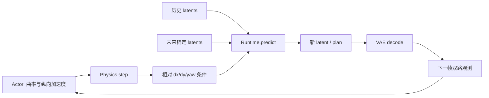

# 03 世界模型：离散视频参考与连续潜空间模拟器

> 实现状态更新：已新增轻量连续 AE 与动作条件 latent 环境；官方 VAE/4B 模型接入仍按本文单独验收。入口见 [训练框架](../training-framework.md)。

公开源码提供两条不同的研究入口。`third_party/commavq` 可直接阅读 CNN/VQ 压缩和自回归 GPT；
`third_party/openpilot.distill/rl` 展示连续潜空间世界模型的加载、条件组织、图像生成和 plan 消费。
后者调用下载的模型包，不能据此声称已取得 0.11/0.11.2 的完整内部训练仓库。

## commaVQ：可以直接定位的结构

| 模块 | 文件/符号 | 输入 → 输出 | 关键实现 |
| --- | --- | --- | --- |
| 视频处理 | `utils/video.py` | 视频帧 → 数组 | 解码、缩放和保存 helper |
| Encoder | `utils/vqvae.py:Encoder` | 图像 → code indices | ResnetBlock、下采样、AttnBlock、向量量化 |
| Codebook | `VectorQuantizer` | 连续特征 → 最近邻索引/embedding | 计算与 embedding 的距离并 argmin |
| Decoder | `Decoder` | indices → RGB | embedding、卷积、残差块与上采样；输出缩放到像素范围 |
| GPT | `utils/gpt.py:GPT` | token 序列 → 下个 token logits | token/position embedding、因果 Attention、MLP、LM head |
| KV cache | `KVCache.update` | 当前 K/V 与位置 → 历史缓存 | 按 input_pos 原位写入，避免重复计算历史 |
| 数据准备 | `nanogpt/prepare.py` | 数据集 token → 平铺训练文件 | 帧 BOS 与段 EOT；训练主程序在外部 nanoGPT |

源码图和准确行号见 [阅读地图](00_source_map.md)。`CompressorConfig` 定义 codebook 大小 1024、
`z_channels=256` 等默认值。公开数据 README 采用每帧 8×16 个离散 token；不要将它与连续世界
模型的 32 通道 latent 混同，也不要将 Python 默认配置自动当成某个 checkpoint 的实测参数。

GPT 默认 `vocab_size=1025`、`tokens_per_frame=129`，包含 128 个视觉 token 和帧分隔 token。
`prepare.py` 另外引入 ID 为 1025 的 EOT，而注释明确原 gpt2m 未按该 EOT 训练。若接入重新准备的
序列，必须同步词表/段边界处理，不能直接用不匹配的预训练 LM head。

这里只找到压缩网络定义、权重加载、推理/数据 helper 和数据转换脚本；没有把 LPIPS/GAN/MAE
等完整压缩器训练 recipe 视为已复现。`gpt2m` 是单独的 HF 模型子模块，当前因网络 403 未取得。

## 连续世界模型：实际可读的接口

distill 的 `rl/server.py:Runtime` 通过 `PackageImporter` 读取模型包的 `model_io`、模型对象及权重，
再调用 `compile_for_inference`。`Runtime.encode/decode` 从另一个 VAE 仓库取得 `encoder.pt2`
和 `decoder.pt2`，输入双路相机拼接的 6 通道像素，归一化到约 [-1,1]，在 CUDA 上执行。

| `Runtime.predict` 输入 | 形状/约束 | 来源 |
| --- | --- | --- |
| `latents` | `[B,F,*latent_shape]`；具体 latent_shape/dtype 从模型元数据取得 | VAE 编码的历史/锚定帧及待预测噪声 |
| `positions` | `[B,F,3]` | 运动学产生的相对位移 |
| `eulers` | `[B,F,3]` | 相对旋转条件 |
| `pose_mask` | `[B,F]` | 哪些位置/姿态条件可用，由模型协议解释 |
| `fidxs` | `[B,F]` | 帧的语义时间索引，不等同内存排列序号 |
| `sampling_steps` / `cfg` | 正确的推理超参数 | RuntimeClient 请求 |

`predict` 调用模型的 `generate(...)`，取新 latent 与 plan，并将 plan 的第一部分重排为 N×15。
每个量的含义须与该模型版本的输出定义核对；wrapper 本身不足以证明完整训练目标和网络规模。
`FUTURE_FRAMES=5` 是 wrapper 的设定；历史长度由 `model_io` 的帧数减去未来帧得出，不能直接
把规划中的 2 秒上下文硬编码为当前 4B 模型的所有输入尺寸。

## 动作如何影响观测

`rl/env.py:Physics.step` 用速度、曲率和纵向加速度形成 5Hz 的简化运动学增量。
`Env.step` 将未来锚定帧、历史与噪声拼接，组织位移/Euler/mask/fidxs，然后更新历史缓存。
当前 wrapper 不是通用 Gym 环境：它有固定相机和 `device_type=mici` 的假设，Episode 要求
comma four 的双摄像头段。任意 comma1M 段不能不经检查就用于该闭环入口。

## 上传规划中 2B/4B 描述的使用方式

规划中的 ViT compressor 参数量、2B/4B DiT 层数、Rectified Flow 训练损失、特定 attention mask
来自论文/发布报告描述；当前未直接访问报告/模型卡，也未下载模型包，故不把它们写成当前
本地源码已验证的常量。可以用这些值建立待验证清单，再与真实 package metadata、导出的网络
结构和可执行采样结果逐项比对。

例如，若采用规划给定的双路 `2×3×128×256` 和 `32×16×32` latent，其元素数量比为 12；
这只是一个尺寸假设下的算术，不是文件压缩率，也不是本次测得的模型 IO。

## 实现路径

先在小规模样本上做压缩/解码 round-trip，再测试固定历史、改变动作时的生成响应。
记录重建误差、可辨识结构、latent 时序变化、采样延迟及显存；画面自然并不证明运动条件正确。
冻结世界模型先验证 policy rollout，不同时更换压缩器与策略。

实验分为 [视频压缩](../../experiments/03_video_compression/README.md) 与
[世界模型](../../experiments/04_world_model/README.md)。当前网络、模型和 GPU 前提尚未满足，
没有生成真实重建质量或动作响应结果。
