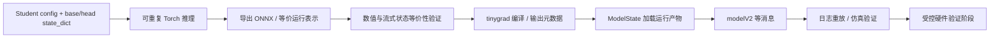

# 07 训练到部署：接口、导出、控制与 CAN

Student 的 `.pt` 检查点、官方 ONNX Teacher 和车端编译的 tinygrad `.pkl` 是不同产物。
部署研究的首要任务是建立可测的转换/适配合同，而不是重命名文件替换现有模型。
核心符号定位见 [源码地图](00_source_map.md)。

## 应验证的导出链路

当前没有实现 Student 到现有 ModelState 的完整 exporter/adapter。社区 Student 与车端模型
的头、状态输入、尺寸和输出切片并不自动一致；如果不实现全部兼容字段，需要明确设计新的
推理适配层，并逐一测试下游读取字段的行为。

## 必须锁定的接口

| 接口 | 要固定的内容 | 推荐验证 |
| --- | --- | --- |
| 图像 | 摄像头/内参、warp、颜色空间、stride、帧堆叠、归一化 | 相同原始帧的预处理数组对齐 |
| 历史状态 | shape、更新次序、reset、dtype、动态 batch | dense/streaming、跨 route reset |
| 条件 | desire pulse、traffic convention、action_t | 条件扰动与缺失场景 |
| 输出 | head 顺序、slice、分布参数、plan、pose、action | 每个消费字段与数值容差 |
| 物理量 | a_lat/a_long、curvature、停止标志、低速约定 | 单位/符号/低速与延迟边界 |
| 执行 | 后端、量化、线程、硬件、模型 hash | 精度误差、延迟尾部、内存、异常行为 |

Teacher、Student 训练与 modeld 的低速曲率换算不能混用：社区 actor 用 `max(speed,1)^2`，
当前 modeld 直接 action 分支用 `max(2.5,v_ego)^2`，还包含低速保持和后处理。

## 当前 tinygrad 编译路径

`openpilot/selfdrive/modeld/SConscript` 指定：

- `driving_supercombo.onnx → driving_tinygrad.pkl`。
- `dmonitoring_model.onnx → dmonitoring_model_tinygrad.pkl`。
- 按真实相机尺寸、stride、NV12 布局编译独立 warp 运行产物。
- 编译入口为 `tinygrad_repo/examples/openpilot/compile_onnx.py` / `compile_warp.py`。

`compile_onnx.py` 保存 metadata、run、input_specs、output_specs；ModelState 根据这些 specs
管理输入、输出及循环状态。仅导出 ONNX 不足以生成完整设备运行产物和相机 warp。

PC 缺少 libLLVM 时，SConscript 会提示并跳过模型编译。因此 `scons` 返回 0 不能单独证明
modeld 模型已经编译成功。需要检查目标 `.pkl` 是否是有效产物、specs 是否正确，并执行实际
前向/状态更新及设备验证。大模型/chestnut 分支还需匹配其专用构建和硬件。

## 模型输出到实际 CAN

1. `get_action_from_model` 输出曲率、纵向加速度与 shouldStop。
2. `plannerd/LongitudinalPlanner` 结合模型、巡航和 MPC 等生成 `aTarget`；controlsd 还处理
   selfdriveState、车辆状态、曲率限制、纵向与横向控制器。
3. `CarControl.Actuators` 保存 torque/steeringAngleDeg/curvature/accel 等字段，具体使用哪些由车型决定。
4. `card.Car.controls_update` 调用 `CarInterface.apply`，车型 `CarController.update` 编码 CAN 帧。
5. `sendcan` 经 native pandad 的发送线程进入 USB/SPI 主机接口，过旧消息会被处理/拒绝。
6. panda `board/drivers/can_common.h:can_send` 调用 `safety_tx_hook`，opendbc safety 配置决定是否允许。

host 侧 Python 控制限幅和 MCU safety hook 是两个检查位置。研究某个车型时，使用 openpilot
内嵌 opendbc/panda 的匹配版本；顶层独立仓库只是另外的阅读版本。

## 实验顺序与验收

| 阶段 | 通过条件 |
| --- | --- |
| Torch → 导出后端 | 同一固定输入及循环状态的数值一致；检查所有下游必需字段 |
| 连续短片段 | reset、首帧、重复/缺失帧、action_t 与低速行为一致 |
| Runtime 模型重放 | 确认新模型实际运行，区分原日志输出和新生成消息 |
| 软件仿真 | 控制延迟、越界、超限、无效输出、禁用/恢复均有可复核结果 |
| 受控硬件阶段 | 匹配车型/固件、安全配置及消息约定，独立验证接管、超时与输出检查 |

本次只完成源码整理，没有进行 CAN 发送、刷写或硬件部署实验。

## 构建环境说明

各上游需要各自环境。执行官方 runtime setup 前应单独准备源码 checkout 与系统依赖，不覆盖
父项目 CPU `.venv`。本版本工具中存在直接访问 `.git/hooks` 的逻辑，而研究目录使用子模块
`.git` 文件；该模式下的 setup/hook 兼容性未验证，因此运行环境优先使用独立的普通 checkout。
源码的读取与子模块固定版本校验不受该运行环境问题影响。

本版本 `lfs.py` 已改用 HF bucket；旧“只执行 git lfs pull”指南不一定适用，应按对应固定版本
的 `tools/op.sh setup` / `tools/lfs.sh` 流程取得资产。当前网络尚不满足模型下载，所有实际构建、
Replay 和部署步骤仍需独立验收。
