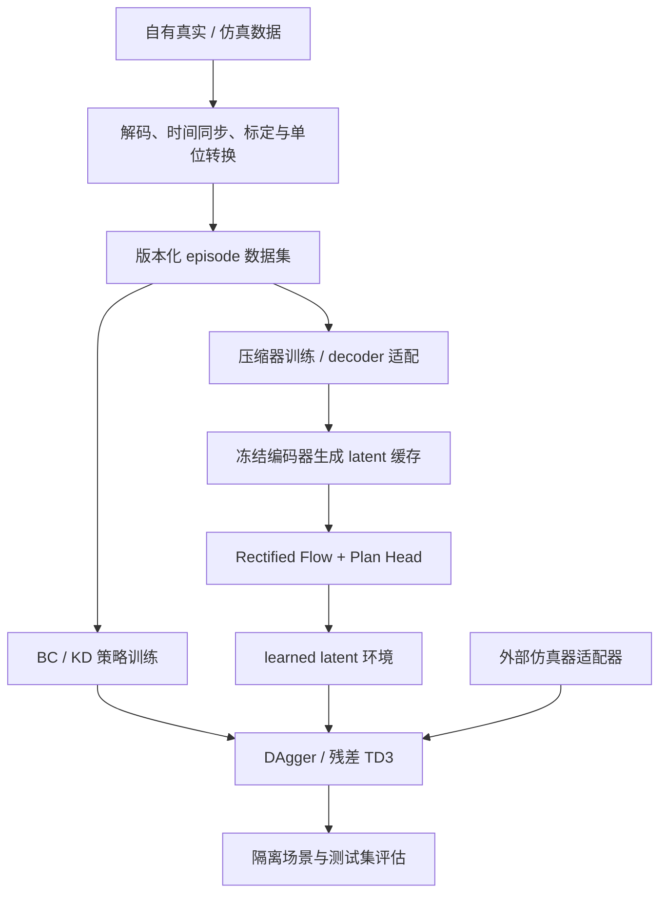

# 自有驾驶数据训练框架

目标是把自有真实驾驶数据和仿真数据接入同一训练管线，依次完成：驾驶策略监督训练、
视觉压缩器训练、潜空间世界模型训练，以及闭环 DAgger / Residual TD3。
入口为 `comma-driving`；本项目的可训练实现位于 `src/comma_post_training/`，
`third_party/` 保持固定版本、原样存放，作为上游接入与源码研究依据。

## 当前能力与边界

| 模块 | 已实现并在 CPU 合成数据验证 | 自有数据接入时需要提供 |
| --- | --- | --- |
| 数据 | NPY mmap、NPZ 导入、按路径延迟解码图片、route 隔离、有效区间、域采样 | 对齐后的图像/状态/动作；世界模型另需位姿 |
| 策略 | 多摄像头 CNN + GRU，BC / KD / 混合监督，冻结视觉编码器适配 | expert 标签；使用 KD 时另需 Teacher 标签 |
| 压缩器 | 连续卷积 Autoencoder，重建训练、仅 decoder 适配、编码器指纹 | RGB 图像，不需要动作标签 |
| 世界模型 | 条件 Rectified Flow、历史与未来锚定帧、独立 XY Plan Head、Euler 采样 | 固定编码器的 latent 缓存、SE(3) 位姿、实际时间戳 |
| DAgger | 当前访问状态查询专家、聚合监督更新、原始训练数据混入 | 支持 expert 查询的环境；默认冻结 CNN，更新融合/GRU/动作头 |
| Residual TD3 | 冻结 base、双 Critic、目标平滑、延迟 Actor 更新、软更新、replay | 环境奖励、最终观测、终止/截断及实际动作 |
| 闭环环境 | 合成点质量环境；原生 learned latent + 平面运动学环境；插件工厂 | 更可信的车辆仿真/世界模型适配器及场景隔离 |
| 训练工程 | 配置检查、独立验证/测试、原子检查点、确定性采样、严格离线续训 | 数据版本、预处理版本、实验预算 |

这些是本项目新建的轻量原生基线。它们不加载 comma 官方 4B 权重，也不等于复现完整的
openpilot 训练流水线。当前没有实现 ONNX Teacher 自动标签生成、官方模型参数映射、LoRA、
多卡训练、生产级视频流 loader 或 modeld 部署转换。已有 Teacher 输出可作为 `teacher_actions`
导入；自己的原生 checkpoint 可用于初始化后继续适配。

## 一、整体结构



| 目录 | 关键入口与职责 |
| --- | --- |
| `data_pipeline/episodes.py` | episode / catalogue 校验、mmap 数组、图片索引、数据指纹 |
| `data_pipeline/windows.py` | 历史窗口、动作移位、连续有效区间、域采样与按 step 复现 |
| `data_pipeline/geometry.py` | 相对 SE(3)、位姿检查、明确的 FLU→FRD 转换 |
| `data_pipeline/prepare.py` | 已对齐 NPZ→NPY，校验成功后发布；构建版本化 manifest |
| `driving_policy/model.py` | 共享视觉 CNN、多视角融合、GRU、两维加速度头 |
| `world_model/compressor.py` | 图像编解码与 encoder 指纹 |
| `world_model/cache.py` | 分批产生派生 latent 数据集，不覆盖源元数据 |
| `world_model/flow.py` | 条件 token、attention mask、Flow velocity 和 Plan Head |
| `world_model/rollout.py` | 独立测试集上的自回归 latent 预测 |
| `engine/config.py` / `tasks.py` | 训练配置、模型规格、损失与评测目标 |
| `engine/trainer.py` / `checkpoints.py` | 训练、验证、初始化、严格续训、原子写入 |
| `simulator/api.py` | 环境工厂、观测/动作/Transition 合同 |
| `simulator/latent.py` | 动作→平面运动→Flow 条件→解码图像→下一次策略观测 |
| `simulator/runner.py` / `td3.py` | DAgger、原始数据混入、残差 TD3、闭环评估 |
| `configs/training/` | 三种离线训练、两种闭环算法及 learned 环境示例 |

这里的路径均相对于 `src/comma_post_training/`。原有 `training.py` 和 `comma-train`
是文本 SFT 环境示例；驾驶训练使用 `engine/`，避免与原模块重名。

## 二、先用合成样本跑通整条链路

在仓库根目录执行。默认锁文件安装 CPU Torch，无需下载外部模型：

```bash
export UV_CACHE_DIR=/workspace/.cache/uv
export UV_SYSTEM_CERTS=true
uv sync --locked --python 3.12

uv run --locked --offline comma-driving make-demo --output-dir data/local/demo
uv run --locked --offline comma-driving validate-dataset data/local/demo/manifest.json

uv run --locked --offline comma-driving train \
  --config configs/training/policy.toml \
  --manifest data/local/demo/manifest.json --output-dir outputs/policy
uv run --locked --offline comma-driving evaluate-checkpoint \
  --checkpoint outputs/policy/best.pt --split test

uv run --locked --offline comma-driving train \
  --config configs/training/compressor.toml \
  --manifest data/local/demo/manifest.json --output-dir outputs/compressor
uv run --locked --offline comma-driving cache-latents \
  --manifest data/local/demo/manifest.json \
  --checkpoint outputs/compressor/best.pt --output-dir data/local/demo-latents

uv run --locked --offline comma-driving train \
  --config configs/training/world_model.toml \
  --manifest data/local/demo-latents/manifest.json --output-dir outputs/world
uv run --locked --offline comma-driving evaluate-checkpoint \
  --checkpoint outputs/world/best.pt --split test
uv run --locked --offline comma-driving rollout-world \
  --checkpoint outputs/world/best.pt --output outputs/world/rollout.pt --frames 3

uv run --locked --offline comma-driving train-closed-loop \
  --config configs/training/dagger.toml
uv run --locked --offline comma-driving train-closed-loop \
  --config configs/training/td3.toml
uv run --locked --offline comma-driving evaluate-closed-loop \
  --config configs/training/td3.toml --checkpoint outputs/td3/final.pt --split test

# 世界模型闭环：配置已指向上面训练的 policy/world/compressor 检查点
uv run --locked --offline comma-driving train-closed-loop \
  --config configs/training/latent_dagger.toml
uv run --locked --offline comma-driving train-closed-loop \
  --config configs/training/latent_td3.toml
```

默认 demo 有六个独立 route，train/val/test 各两个，每段 24 帧。合成 Teacher 标签也由公式产生，
没有调用 openpilot。默认图像只有 16×32，用来验证工程流程；正式训练应扩大尺寸和模型容量。
输出目录不允许覆盖非空目录；重复实验需要新目录。数据生成与训练结果均在 Git 忽略目录内。

若 `best.pt` 的 step 是 0，表示初始模型在该验证目标上优于后续模型，并非文件保存失败。
可用 `last.pt` 诊断最后一次训练，但实验选择应使用验证集选出的 checkpoint。

## 三、替换为自己的数据

详细字段、样例、坐标和时间定义见 [数据接入合同](training-data.md)。推荐先转换 2～10 个完整
route，确认独立 train/val/test 都可采样，再逐渐扩大规模。无需先取得 comma1M 或官方模型。

```bash
# 一段已经同步的 numeric NPZ + 元数据；每个 episode 重复执行
uv run --locked --offline comma-driving import-npz \
  --input /path/to/aligned-episode.npz \
  --metadata /path/to/episode-metadata.json \
  --output-dir data/local/own-v1/episodes/route001-segment000

uv run --locked --offline comma-driving build-dataset \
  --root data/local/own-v1 --revision own-v1 --kind recorded
uv run --locked --offline comma-driving validate-dataset data/local/own-v1/manifest.json
uv run --locked --offline comma-driving train \
  --config configs/training/policy.toml \
  --manifest data/local/own-v1/manifest.json --output-dir outputs/own-bc
```

`import-npz` 将数组展开为 `.npy`，训练时 mmap 读取；正式大数据可由自己的转换器直接写 NPY，
避免将整段视频压进 NPZ。图片可通过 JSON 路径索引延迟读取。原始 MP4/HEVC、ROS bag、
LeRobot Parquet/视频、RLDS/TFRecord 和 HDF5 都需要先导出为这个中间合同；当前没有自动
识别它们的隐式转换器，也不会猜测缺失时间戳、相机内参或动作含义。

策略 BC 只需图像、状态、已执行动作历史和 expert 标签；压缩器只用图像，但共享 episode
合同仍保留状态与动作以便复用数据。世界模型还需要位姿与 latent 缓存，不要求 expert 标签。
若原始采集只有方向盘角、油门、刹车，应先通过车辆/控制器模型构造明确的加速度监督，
不能直接给字段改名。姿态、速度导出的实际加速度也不自动等同于期望控制指令。

真实与仿真数据可以放入同一 manifest，分别标记 `domain="real"` / `"sim"`。
保持摄像头顺序、状态特征、坐标和 `preprocessing_id` 一致后，在配置中设置：

```toml
[data]
manifest = "../../data/local/own-v1/manifest.json"
history = 4
image_size = [128, 256]
max_gap_s = 0.12
domain_mix = { real = 0.7, sim = 0.3 }
```

这是抽样概率比例；不设置时按所有有效窗口均匀抽样。只列出 real 时只采 real。
若列出的域没有可用训练窗口，程序直接报错。采样采用替换抽样和 step 预算，没有 epoch 语义。
`max_gap_s` 应按真实采样率设置；它用于切断不连续区间，不会重采样数据。

## 四、策略 SFT / BC / KD

`images[B,T,V,3,H,W]` → 各视角共享 CNN → 拼接车辆状态、前一帧实际动作和 `dt`
→ 融合层 → GRU → 当前时刻 `[a_lat,a_long]`。推理输入没有当前标签、未来图像或未来位姿。
第一帧/间断后的历史动作置零，后续每帧输入上一时刻的 `executed_actions`。

```toml
[loss]
bc_weight = 1.0
kd_weight = 1.0
```

两种监督分别按自己的有效 mask 求 MSE，再按权重相加；它们不要求每一帧同时存在。
训练集的抽样域和验证集必须包含每个启用损失的监督源。不要用零标签填补缺失 Teacher。
评估时仍会报告每种可用标签的 MAE/MSE；若测试集缺少某个训练监督源，总 `loss` 为 null，
防止把删掉损失项后的分数与训练目标混淆。

微调原生模型时配置 `model.init_checkpoint` 或使用 `--init-checkpoint`：

```bash
uv run --locked --offline comma-driving train \
  --config configs/training/policy.toml \
  --manifest data/local/new-domain-v1/manifest.json \
  --init-checkpoint outputs/policy/best.pt --output-dir outputs/adapted-policy
```

架构、相机/状态含义必须兼容；新任务可以更换数据版本与学习率。配置 `freeze_encoder=true`
可冻结 CNN，仅训练融合/时序/动作层；它需要初始化 checkpoint，避免冻结随机编码器。
当前不是 ONNX→PyTorch 微调，也没有自动 LoRA 注入。

开环报告包含每轴加速度 MAE、BC/KD MSE、有效样本数和分域结果。现有 `comma-driving evaluate`
仍用于已对齐轨迹 JSONL 的 ADE/FDE/jerk；策略目前只输出动作，不自动生成可信的长期轨迹。

## 五、压缩器与世界模型

压缩器把多摄像头 RGB 在通道维拼接，卷积下采样 4 倍，decoder 反卷积重建，损失为像素 MSE。
它是连续 Autoencoder，不是 commaVQ tokenizer，也没有官方 VAE 的 KL/perceptual/对抗损失。

建议先训练/适配压缩器，检查图像重建后冻结 encoder，再运行 `cache-latents`。
缓存保留源数据引用，创建独立 manifest，并记录 encoder 权重与结构指纹、checkpoint SHA256。
只改 decoder 时编码器指纹不变；修改 encoder 后必须生成新缓存并重训或明确适配 Flow。
原始图像/元数据不会被 latent 导出覆盖。派生缓存依赖原始文件，搬迁时须同步更新路径与版本。

Flow 的每个帧 latent 展平为一个 token。这使实现简单，但高分辨率下投影参数量增长，
不能直接用它代替 4B 空间 patch Transformer。条件包括：

- 历史帧 latent；未来参考锚定帧（默认偏移 +2、+3）；各帧相对秒数。
- 从当前位姿到 +1 目标帧的 `[dx,dy,dz,roll,pitch,yaw]`，平移单位米、角度弧度。
- 独立噪声时间 τ；目标位置 +1 不允许出现在 anchor 列表中。

训练取高斯噪声 ε、数据 latent z，构造 `zτ=(1−τ)ε+τz`，监督 velocity `z−ε`；
损失为 `flow_mse + plan_weight × plan_mse`。Plan Head 预测未来自车坐标的 XY，单位米。
known tokens 在所有层都禁止读取 noisy target，因此 Plan Head 不会从目标 latent 或运动条件
偷看标签；它仍能看到显式提供的未来 anchors，这是一种 privileged conditioning。

采样从高斯噪声出发，按 `world.sampling_steps` 做 Euler 积分。
可设置 `world.anchor_offsets=[]` 关闭未来锚定帧，作为 privileged conditioning 的消融；
这会改变模型规格，需要新训练实验。
`rollout-world` 会把前一次生成的 latent 放回历史，输出 latent/plan 及误差；它使用独立测试集
记录的运动和未来锚定帧，属于条件自回归预测，不是策略控制环境，也不代表闭环驾驶成功率。

## 六、闭环后训练与环境适配

`simulator/api.py` 定义统一接口。工厂调用为：

```python
env = factory(spec=policy_model_spec, split="train", **env_kwargs)
obs = env.reset(seed=42)
expert = env.expert_action()  # DAgger 需要在当前访问状态查询
transition = env.step(commanded_acceleration)
env.close()
```

观测包含 `images[T,V,3,H,W]`、`state[T,D]`、`past_actions[T,2]`、`dt[T,1]`。
图像 RGB float 在 [0,1]，动作是 FRD 语义下的 `[a_lat,a_long] m/s²`。
`Transition` 包含下一观测、标量 reward、`terminated`、`truncated` 和 `achieved_action`。
必须返回截断前的最终观测，不能返回自动 reset 后另一条 episode 的首帧。
`describe()` 返回名称/版本、`kind="synthetic"|"simulator"`、请求的 split；同时应记录地图、
车辆、传感器、reward 和场景版本。工厂按 split 选择隔离场景池，不能只换随机种子。

在 TOML 中设置 `env_factory="your_package.adapter:create_env"`，并通过 `[env_kwargs]`
传入参数。外部包需要安装到当前训练环境。不要在 wrapper 中丢弃动作，也不要按原始视频
顺序返回下一帧后声称完成动作条件仿真。CARLA/其他仿真器的左/右手坐标、控制频率及
steer/throttle/brake 转换必须由适配器实现；目前没有已验证的 CARLA 专用 adapter。

**DAgger**：每步在当前访问状态查询专家并加入有界 FIFO 聚合池；按 `expert_mix` 概率执行
专家动作，其余执行当前策略。CNN 固定，缓存视觉特征以降低内存；优化融合/GRU/动作头。
`offline_fraction` 指定每批原始 expert 数据比例，来源只限 base 配置中的 train split。
默认 0.5，设 0 可只用在线聚合数据。容量耗尽时淘汰旧样本，属于有界 DAgger-style 变体。
视觉骨干固定的前提下才允许复用缓存特征；若研究视觉层更新，应改为图像 replay。

**TD3**：base CNN/GRU/动作头全部冻结；Residual Actor 接收因果 features 和 base 动作。
最终指令为 `clip(base + residual_scale × tanh(actor), action_low, action_high)`。
Critic 的 action 一致定义为最终发出的指令；实际加速度单独存储，可由环境用于状态和奖励。
下一步 target 包含 next base，双 Critic 取小值，目标动作加噪声后限幅；按 policy_delay
延迟更新 Actor，并软更新 targets。真实终止不 bootstrap；时间截断从最终观测 bootstrap。
额外 `residual_penalty` 约束修正幅度，动作平滑性应由明确的 reward/动力学定义。
配置中的动作上下限只是实验约束，需要按仿真车辆标定。

两类环境的用途不同：

| 环境 | 动作如何改变后续状态 | 限制 |
| --- | --- | --- |
| `reference:ReferenceEnvironment` | 点质量积分，图像由位置/速度着色 | 合成算法 fixture，不是道路仿真器 |
| `latent:LatentDrivingEnvironment` | 简化执行滞后→平面 SE(3)→Flow 条件→decoder 图像→策略 | 固定速度/yaw-rate 两维状态；参考未来 anchors；无碰撞/接触物理 |
| 自定义 factory | 由实际仿真器或验证后的世界模型提供 | 需要验证动作响应、时间对齐和真实数据上的 fidelity |

learned 环境使用对应 split 的参考 route，初始化真实历史，之后回灌生成帧。
每一步的运动来自当前动作与简化运动学，不采用记录中的下一步位姿作为生成条件。
参考位姿/速度仅用于 proxy reward，Plan Head + 简单控制器可充当 DAgger proxy expert；
它不是 openpilot Teacher，也不证明偏离状态的标签正确。需要对世界模型误差、参考锚定依赖、
训练策略钻模型漏洞等分别设计消融。先在外部可信仿真器验证改善，再讨论真实驾驶泛化。

闭环训练用独立 train / val 环境，固定验证种子，最终通过 `evaluate-closed-loop --split test`
评价隔离场景；默认 reference 中 split 仅是合成池标识，不能解释成真实道路划分。
当前单环境串行采样，每步最多一次更新；不是异步 Near On-Policy 系统。

## 七、产物、续训与可复现性

离线训练目录包含：

```text
run.json         配置、模型规格、数据指纹、源码 hash、设备与初始化来源
events.jsonl     step、loss、梯度范数、定期验证
initial.pt       开始时的完整状态（新目录的续训分支从其起始 step 保存）
best.pt          验证目标最优状态，初始模型也参与比较
last.pt          最近一次验证时的完整状态
metrics.json     初始/最终验证指标、窗口数、域与产物路径
```

检查点在验证间隔和结束时写入，包含模型、优化器、RNG、step、数据/配置/源码签名。
`--max-steps` 表示累计目标 step，不是额外步数。续训时除了总步数和输出目录，其他合同须一致：

```bash
uv run --locked --offline comma-driving train \
  --config configs/training/policy.toml \
  --manifest data/local/demo/manifest.json --output-dir outputs/policy \
  --resume outputs/policy/last.pt --max-steps 60
```

CPU 测试逐参数验证连续训练与分段续训完全一致。CUDA 不同版本/内核不承诺逐位一致。
更改数据、学习率、模型或源码时使用 `--init-checkpoint` 开新实验。
在 CPU 上检查原生 GPU 训练产物时，`evaluate-checkpoint` 与 `rollout-world` 可加
`--device cpu` 覆盖检查点中保存的训练设备。
不允许用旧 step 覆盖同目录中更新的 last；可换新 output_dir 建分支。新目录的 best 只覆盖
该续训分支，不复制历史最优权重。数据指纹覆盖 manifest/元数据内容及文件大小/mtime，
并非所有原始数据的全字节密码学校验；严肃实验还应保存外部不可变数据版本/哈希清单。

闭环目录包含 `run.json`、逐步指令/实际动作事件、`final.pt`、`learning_state.pt`、指标。
后者保存 learner 与 replay 供分析，但当前没有仿真器状态快照协议，因此不提供在线精确续训。
DAgger 导出的策略可做开环评测和新的离线初始化；TD3 residual 导出需通过闭环评估器加载。
本版本导出 final，不自动按验证分数选在线 best。

## 八、计算资源与下一步

默认 CPU、小图像、小网络适合开发检查；真实视觉实验首先量测解码吞吐、峰值显存、
训练吞吐与重建质量，再增加 `image_size`、history、隐藏维度、batch。加载器使用 mmap 与
有界 episode 缓存；校验会扫描数值元数据和位姿，首次启动大数据时会有明显开销。
当前没有 DDP、混合精度、分片压缩视频或云流式数据支持。

GPU 训练需要独立 CUDA Torch 环境，参见 [GPU 说明](gpu-reproduction.md)。
根目录的 CPU 锁不会因 `--device cuda` 自动切换 wheel。RTX 3090 Ti 可以优先运行这里的
轻量模型；官方 4B 的量化算子与硬件约束要另行验证。本云实例没有 GPU，未进行 CUDA 验收。

建议接入顺序：

1. 两个以上训练 route + 独立验证/测试 route：核对时钟、相机标定、动作符号与单位。
2. 小数据 BC 过拟合，再在固定数据与预算下比较 BC / KD / BC+KD。
3. 压缩器重建检查、冻结 encoder、缓存 latent、Flow/Plan 单步与短预测。
4. 在可信仿真器做动作响应检查和固定扰动基准，然后比较继续 SFT、DAgger、残差 TD3。
5. 扩大数据与种子数，报告分域/分场景结果、失败率、计算预算及世界模型误差。

上游官方接入、真实回放与部署研究继续参照 [源码手册](source-study/README.md)。
