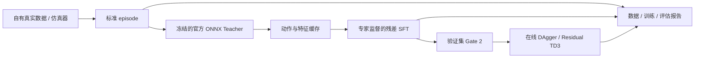

# comma-post-training 完整使用手册

**面向任务：复现 comma 官方驾驶模型推理，冻结官方基座，使用自有驾驶数据训练残差策略，并开展仿真闭环后训练和结果可视化。**

文档日期：2026-11-09。依据仓库 `5c32c0d` 的实际 CLI、配置及实现编写。
适用平台：Linux、Python 3.12；GPU 示例对应用户已验证的 RTX 3090、CUDA PyTorch 环境。
后续版本若有接口变化，以当前 checkout 的 `--help` 和配置加载器为准。

**新环境适配增补**：见 [监督微调 → 闭环纠错 → 世界模型技术路线](adaptation-roadmap.md)。
该文包含新增的可训练空间 Student、独立预测、数据审计/组合、固定扰动 benchmark、
配对 val 准入和保守 TD3 配置；本手册原有官方冻结基座流程继续适用。

## 目录

1. [项目定位与当前能力](#1-项目定位与当前能力)
2. [已有本地结果从哪里继续](#2-已有本地结果从哪里继续)
3. [目录与程序入口](#3-目录与程序入口)
4. [获取仓库及恢复上游源码](#4-获取仓库及恢复上游源码)
5. [安装环境与健康检查](#5-安装环境与健康检查)
6. [路径版本与输出目录规则](#6-路径版本与输出目录规则)
7. [下载与校验官方模型](#7-下载与校验官方模型)
8. [Teacher inspect与smoke验收](#8-teacher-inspect与smoke验收)
9. [生成标准仿真数据](#9-生成标准仿真数据)
10. [自有数据格式与时间对齐](#10-自有数据格式与时间对齐)
11. [导入自有数据与划分数据集](#11-导入自有数据与划分数据集)
12. [生成Teacher缓存](#12-生成teacher缓存)
13. [训练离线残差策略](#13-训练离线残差策略)
14. [开环评估与Gate-2](#14-开环评估与gate-2)
15. [检查点初始化与续训](#15-检查点初始化与续训)
16. [配置官方基座闭环实验](#16-配置官方基座闭环实验)
17. [DAgger与Residual-TD3](#17-dagger与residual-td3)
18. [闭环评估与真实rollout记录](#18-闭环评估与真实rollout记录)
19. [可视化报告与结果导出](#19-可视化报告与结果导出)
20. [怎样判读结果和设计对照](#20-怎样判读结果和设计对照)
21. [原生轻量模型研究路径](#21-原生轻量模型研究路径)
22. [接入自有仿真器与扩展接口](#22-接入自有仿真器与扩展接口)
23. [常用配置参数参考](#23-常用配置参数参考)
24. [完整CLI索引](#24-完整cli索引)
25. [常见问题与排查](#25-常见问题与排查)
26. [保存实验与同步GitHub](#26-保存实验与同步github)
27. [测试验证与离线使用](#27-测试验证与离线使用)
28. [后续阶段与专项文档](#28-后续阶段与专项文档)

---

## 1. 项目定位与当前能力

### 1.1 当前主线



官方 ONNX 提供驾驶动作及视觉时序特征。训练器更新本项目的残差 head；
官方 ONNX 权重始终作为固定推理资产，不进入 PyTorch optimizer。

你选择的路线是“冻结官方基座，训练附加策略”，不是更新官方网络原参数。
因此当前不需要把 ONNX 强行转换为可训练 PyTorch 模型，也没有在官方 ONNX 上实现 LoRA。

### 1.2 已提供的功能

| 能力 | 当前实现 | 使用入口 |
| --- | --- | --- |
| 固定官方模型身份 | 模型 commit、大小和 SHA256 校验 | `comma-teacher verify` |
| 官方驾驶模型推理 | 原始 ONNX、RGB→YUV420、历史队列、5 Hz、reset、warmup | `inspect`、`smoke`、`cache` |
| 仿真数据导出 | 双视角 pinhole、时间戳、状态、位姿、专家和实际动作 | `comma-driving record-sim` |
| 自有数据导入 | 已对齐 NPZ / NPY / 图片路径、route 拆分和格式检查 | `import-npz`、`build-dataset` |
| 官方动作和特征缓存 | 512 维特征、动作、有效 mask 与来源 | `comma-teacher cache` |
| 冻结基座残差训练 | 有界 MLP 修正、BC 专家监督、KD 基座约束 | `comma-driving train`，任务 `official_residual` |
| 开环与准入评估 | 实时组合推理、逐 route/逐轴误差、jerk、Gate 2 | `predict-adapted`、`gate-residual` |
| 官方基座闭环 | 当前状态专家查询的 DAgger、保留离线 anchor 的 TD3 | `train-official` |
| 组合策略评估 | 官方、离线 head、在线策略、独立 val/test | `evaluate-official` |
| 策略评估画面 | 可选记录实际访问的图像、动作、奖励和位姿 | `evaluate-official --trace-dir` |
| 结果可视化 | 离线 HTML、同步相机、曲线、PNG/SVG/CSV/GIF | `comma-driving report` |
| 原生算法基线 | CNN/GRU、AE、latent Flow、原生 DAgger/TD3 | 第 21 章 |

### 1.3 当前边界

内置道路环境是确定性的合成工程 backend，用来验证数据、状态和训练链路；
它没有实现 MetaDrive/CARLA 的真实车辆动力学、交通参与者与完整驾驶场景。
MetaDrive/CARLA 需要另外编写并验证 adapter。

本项目也尚未完成官方 Student 多任务训练流水线、官方 VAE/4B 世界模型适配、
完整车端 modeld 输出后处理、车辆控制和硬件部署。当前输出加速度未包含完整车端平滑与控制链。

### 1.4 现有验收应怎样理解

用户本地最新摘要报告：官方 v2 Teacher 在 RTX 3090 上执行 60 帧 CUDA smoke，
其中 35 帧 warmed，完整 reset 重放一致；官方 Teacher 缓存 500 个仿真有效标签；
离线残差 val 误差改善，但 100 环境步的 DAgger/TD3 回报退化。

云端另外完成 126 项工程回归，以及合成 ONNX 下的完整链路和浏览器回放检查。
两类证据分别记录：

- [用户本地结果摘要](acceptance/local-rtx3090-20261109/README.md)：真实官方权重的用户报告，原始逐步产物仍在本地。
- [云端可视化验收](acceptance/visualization-20261109/README.md)：CPU、合成 ONNX、工程与浏览器测试。

---

## 2. 已有本地结果从哪里继续

如果已经完成此前的 `v2` 实验，可以直接复用结果，不必为了生成图表重新训练。

### 2.1 已有产物对照

| 目录 | 内容 |
| --- | --- |
| `models/big_driving_supercombo.onnx` | 已下载的官方模型 |
| `outputs/acceptance/p0-v2/` | inspect、smoke、ORT profile |
| `data/local/sim-pilot-v2/` | 4 条 30 秒仿真 episode |
| `data/local/sim-teacher-v2/` | 官方 Teacher 特征和动作缓存 |
| `outputs/official-residual-sim-v2/` | SFT 检查点、训练事件与指标 |
| `outputs/official-residual-sim-v2-val/` | val 逐帧预测、误差和 Gate 2 |
| `outputs/official-dagger-v2/` | 在线 DAgger 产物 |
| `outputs/official-td3-v2/` | 在线 TD3 产物 |

### 2.2 最快生成完整报告

在仓库根目录执行：

```bash
uv pip install --python .venv-gpu/bin/python "matplotlib>=3.10,<4"

.venv-gpu/bin/comma-driving report \
  --manifest data/local/sim-teacher-v2/manifest.json \
  --smoke outputs/acceptance/p0-v2/smoke.json \
  --run-dir outputs/official-residual-sim-v2 \
  --run-dir outputs/official-dagger-v2 \
  --run-dir outputs/official-td3-v2 \
  --prediction-dir outputs/official-residual-sim-v2-val \
  --output-dir outputs/reports/local-v2-guide --gif
```

如果 smoke 文件名字不同，替换 `--smoke` 参数，或暂时省略它。
打开 `outputs/reports/local-v2-guide/index.html`。

报告直接读 JSON、JSONL、NPY 和图片，不重新执行 Teacher，也不加载训练检查点。
因此只看已有产物时无需进行 GPU 推理。

### 2.3 当前最值得继续的工作

先保留通过 Gate 2 的离线 `best.pt`，对官方基座、离线残差、DAgger、TD3 做相同场景的评估 trace。
重点检查 TD3 的终止标志、控制步数、动作变化和道路偏差，方法见第 18、20 章。
世界模型适配继续延期，当前先把驾驶策略的效果判断做可靠。

---

## 3. 目录与程序入口

```text
comma-post-training/
├── README.md
├── pyproject.toml / uv.lock           Python 包、依赖与 CPU 开发锁
├── configs/
│   ├── teacher/                      官方模型身份与 RGB profile 模板
│   ├── training/                     离线、原生闭环和官方闭环配置
│   └── driving/                      上游资产锁和研究实验登记
├── src/comma_post_training/
│   ├── data_pipeline/                episode、导入、时间窗口和坐标处理
│   ├── teacher/                      权重校验、推理、缓存、残差和 Gate 2
│   ├── engine/                       训练配置、优化、验证和离线续训
│   ├── simulator/                    环境接口、录制、在线算法和 trace
│   ├── reporting/                    离线 HTML 与 PNG/SVG/CSV/GIF
│   ├── driving_policy/               原生 CNN/GRU 策略
│   ├── world_model/                  原生 AE 和 latent Flow
│   └── driving/                      驾驶工具 CLI 与旧版评测工具
├── third_party/                      固定 Git 子模块，上游源码保持原样
├── tests/                            数据、训练、Teacher、闭环和报告测试
├── scripts/                          上游源码与锚点核查
├── docs/                             手册、专题说明和验收记录
├── models/                           本地模型权重，忽略目录
├── data/local/                       本地原始数据与缓存，忽略目录
└── outputs/                          检查点、日志、报告、trace，忽略目录
```

`models/`、`outputs/` 等本地目录按需创建，Git clone 后不一定存在。

| 程序 | 主要用途 | 最常用命令 |
| --- | --- | --- |
| `comma-teacher` | 官方模型资产与推理 | `verify`、`smoke`、`cache`、`predict-adapted` |
| `comma-driving` | 数据、驾驶训练、评估、报告 | `record-sim`、`train`、`train-official`、`report` |
| `comma-train` | 初始项目保留的微型文本 SFT 示例 | `doctor`、`validate-data`、`train`、`generate` |

驾驶实验主要使用前两个入口。`comma-train` 的文本训练不训练驾驶策略。

---

## 4. 获取仓库及恢复上游源码

### 4.1 克隆父仓库

你的网络只支持 GitHub SSH 时，可以使用：

```bash
git clone git@github.com:Xb445/comma-post-training.git
cd comma-post-training
git status --short
git log -1 --oneline
```

工作区已有本地修改时，先提交或备份它们，再同步新的远端提交。
源码通过 editable 安装后，后续 Git 修改通常直接生效；新增依赖仍需单独安装。

### 4.2 为什么 third_party 为空

父仓库记录的是子模块 commit 引用，不包含子模块全部文件。
普通 clone 不会自动取回这些独立仓库。读取官方源码需要初始化子模块；
本项目自己的数据/残差/报告实现主要位于 `src/`，不应把子模块为空误认为这些 Python 实现缺失。

### 4.3 通过 SSH 初始化子模块

下面仅针对这些命令将 GitHub HTTPS URL 转为 SSH，不改写共享 `.gitmodules`：

```bash
GIT_LFS_SKIP_SMUDGE=1 git \
  -c url."git@github.com:".insteadOf=https://github.com/ \
  submodule update --init --depth 1 --filter=blob:none --jobs 3

GIT_LFS_SKIP_SMUDGE=1 git \
  -c url."git@github.com:".insteadOf=https://github.com/ \
  -C third_party/openpilot submodule update \
  --init --recursive --depth 1 --filter=blob:none --jobs 3
```

第一条恢复五个直接上游；第二条只递归恢复 openpilot 内部的源码依赖。
这样不会顺带初始化 commaVQ 的可选 Hugging Face `gpt2m` 模型仓库。

只支持 SSH clone 并不等于支持所有下载：PyPI、PyTorch wheel、模型 HTTP 下载和 Hugging Face
各自需要可用网络。Git URL rewrite 只解决 GitHub Git 仓库的传输。

### 4.4 检查源码版本

```bash
python scripts/verify_sources.py
python scripts/source_map.py --check
```

只检查父仓库的锁文件及 gitlink，不要求已下载源码时：

```bash
python scripts/verify_sources.py --metadata-only
```

`openpilot.distill` 为社区研究项目，其余四个直接子模块来自 comma.ai。
系统研究用的 `third_party/openpilot` 快照是 `493ae5a…`，Teacher 权重固定在 `084747c…`，
两者用途不同。推理 adapter 按 Teacher 固定版本实现，不从不同版本主仓库随意取常量。
具体上游 commit 和版本恢复方法见 [third_party 说明](../third_party/README.md)。

---

## 5. 安装环境与健康检查

### 5.1 环境选择

| 情况 | 建议环境 |
| --- | --- |
| 已有本地 Teacher CUDA 验收 | 继续使用 `.venv-gpu/`，只补缺少的依赖 |
| 无 GPU 的接口、单测、原生模型开发 | `.venv/`，使用项目 CPU 锁文件 |
| 全新本地 CUDA 环境 | 独立创建 `.venv-gpu/`，显式安装 CUDA Torch 与 GPU ORT |
| 上游 Student 或官方世界模型 | 后续独立环境；按其 Python、GPU 和量化算子要求配置 |

项目要求 Python `>=3.12,<3.13`。默认 `uv.lock` 的 Torch 来源是 CPU 索引。
`uv sync` 面向这个 CPU 配置；已有 GPU 环境应使用对应 Python 的 `uv pip install` 补包，
避免把已验证 CUDA 依赖替换为 CPU wheel。

### 5.2 CPU 开发环境

```bash
uv sync --locked --extra teacher --extra visualization --python 3.12
.venv/bin/comma-driving --help
.venv/bin/comma-teacher --help
```

如果所在云环境将 home 下缓存设为只读，可将缓存放在允许写入的项目工作区：

```bash
export UV_CACHE_DIR=/workspace/.cache/uv
export UV_SYSTEM_CERTS=true
```

这些路径是云端示例，本地机器可使用默认缓存。

### 5.3 已有 GPU 环境

先查看版本和 provider，不必重装：

```bash
.venv-gpu/bin/python - <<'PY'
import sys
import torch
import onnxruntime as ort
print("Python:", sys.version)
print("Torch:", torch.__version__)
print("Torch CUDA:", torch.version.cuda)
print("CUDA available:", torch.cuda.is_available())
if torch.cuda.is_available():
    print("GPU:", torch.cuda.get_device_name(0))
print("ORT:", ort.__version__)
print("ORT providers:", ort.get_available_providers())
PY
```

只补图表或开发依赖：

```bash
uv pip install --python .venv-gpu/bin/python "matplotlib>=3.10,<4"
uv pip install --python .venv-gpu/bin/python "ruff>=0.14,<1" "pytest>=8,<10"
```

### 5.4 全新 GPU 环境示例

下面对应用户验证过的 Torch 2.8 / CUDA 12.8 路线；不同驱动和 GPU 请选择兼容 wheel。
创建新目录，不覆盖既有可用环境：

```bash
uv venv .venv-gpu --python 3.12

uv pip install --python .venv-gpu/bin/python \
  --index-url https://download.pytorch.org/whl/cu128 "torch==2.8.0"

uv pip install --python .venv-gpu/bin/python \
  -e ".[visualization]" \
  "onnx>=1.17,<2" "onnxruntime-gpu==1.31.1" \
  "opencv-python-headless>=4.10,<5" \
  "ruff>=0.14,<1" "pytest>=8,<10"
```

这里显式安装 GPU ORT，没有选 `teacher` extra，因为该 extra 默认声明 CPU `onnxruntime`。
不要同时保留 CPU 和 GPU 两种 ORT wheel；它们使用同一个 Python import 命名空间。
新环境安装后仍需执行后面的 `verify`、`inspect` 和 CUDA smoke，不能仅凭安装成功判断可推理。

### 5.5 两套计算设备分别设置

`--provider cuda` 指 **ONNX Teacher** 的执行 provider。
`--device cuda` 指 **PyTorch 残差头或原生模型** 的设备。
两者独立；官方 Teacher 使用 GPU、很小的 residual head 使用 CPU，是当前模板的正常配置。

用户日志中的 GPU 为 RTX 3090 24 GB；`nvidia-smi` 的 CUDA 13.0 是驱动支持上限，
不代表 Torch 使用的 runtime 也必须是 13.0。用户已验证的 Torch runtime 是 12.8。

---

## 6. 路径版本与输出目录规则

### 6.1 本手册的新实验命名

从第 7 章开始用 `exp001` 演示全新实验，避免覆盖已有 `v2` 结果：

```text
models/big_driving_supercombo.onnx
data/local/sim-exp001/                         原始录制
data/local/sim-exp001-teacher/                 Teacher 派生缓存
outputs/acceptance/exp001/                    Teacher 验收
outputs/official-residual-exp001/             离线训练
outputs/official-residual-exp001-val/         验证预测与 Gate 2
outputs/official-dagger-exp001/               在线 DAgger
outputs/official-td3-exp001/                  在线 TD3
outputs/evaluation-exp001/                   策略评估 trace
outputs/reports/exp001/                      可视化
```

重复实验换成 `exp002`、新的 seed 名称或自己的实验编号。

### 6.2 路径如何解析

- CLI 里的相对路径：相对运行命令时的工作目录，本文统一在仓库根目录。
- TOML 里的 `manifest`、`output_dir`、checkpoint 和模型路径：相对 **TOML 文件所在目录**。
- episode 的 NPY / 图片索引路径：相对 `episode.json`；图片文件路径相对索引文件。
- Teacher/latent 派生缓存会引用原始文件绝对路径，移动缓存时也要处理来源引用。

例如 `configs/training/official_td3.toml` 中的 `../../models/...` 才指向项目根目录。
把这个配置复制到更深目录却保留 `../../` 会改变含义。

### 6.3 拒绝覆盖是正常行为

录制、缓存、预测、报告和新闭环训练均要求目标目录为空或不存在。
这样不会把不同 seed、不同模型和不同数据的产物混成同一个实验。

离线 `train --resume` 在符合续训签名时可接续原 run；普通新训练不能写入已有非空训练目录。
smoke/inspect 的显式输出文件和 Gate 输出也不应覆盖，选择新的文件名即可。

---

## 7. 下载与校验官方模型

### 7.1 固定资产身份

```text
repository: commaai/openpilot
commit: 084747c75d2cbd23af65ab7a9e770bbd7b98bac9
artifact: openpilot/selfdrive/modeld/models/big_driving_supercombo.onnx
size: 1,757,355,221 bytes
sha256: a501760a9d1d5fef0eab2b8c5d122d06124fc26dc8e0782e0aa94b82a208f0ff
adapter: supercombo-084747-stream-5hz-v2
```

原始权重下载地址：

<https://media.githubusercontent.com/media/commaai/openpilot/084747c75d2cbd23af65ab7a9e770bbd7b98bac9/openpilot/selfdrive/modeld/models/big_driving_supercombo.onnx>

GitHub 普通源码地址可能只提供 LFS 指针文本；几百字节的指针不是实际模型。
模型清单见 [official-084747c.json](../configs/teacher/official-084747c.json)。

### 7.2 下载和验收

```bash
.venv-gpu/bin/comma-teacher fetch \
  --model models/big_driving_supercombo.onnx

.venv-gpu/bin/comma-teacher verify \
  --model models/big_driving_supercombo.onnx
```

已经下载好时只执行 verify。程序核查大小和完整 SHA256，不依赖文件名判断身份。
云端历史媒体域名 403 不影响你已在本地下载完成的文件。

CLI 默认模型路径是 `models/openpilot-084747c/big_driving_supercombo.onnx`；
本文统一显式传 `--model models/big_driving_supercombo.onnx`，避免两个目录混淆。
所有权重保持在 Git 忽略的 `models/`；GitHub 保存清单与验收摘要。

---

## 8. Teacher inspect与smoke验收

### 8.1 查看实际接口

```bash
.venv-gpu/bin/comma-teacher inspect \
  --model models/big_driving_supercombo.onnx --provider cuda \
  --output outputs/acceptance/exp001/inspect.json
```

主要预期：

| 输入 | shape | dtype | 含义 |
| --- | --- | --- | --- |
| `img`、`big_img` | `[1,12,128,256]` | uint8 | 每路当前/历史 RGB 转换后的 YUV420 平面 |
| `features_buffer` | `[1,24,512]` | float16 | 视觉时序特征历史 |
| `desire_pulse` | `[1,25,8]` | float16 | 意图上升沿历史 |
| `traffic_convention` | `[1,2]` | float16 | 通行侧条件 |
| `action_t` | `[1,2]` | float16 | 两轴动作时间条件，秒 |

源 RGB 为每路 **256×512，H×W**。打包后的网络 tensor 空间尺寸减半，
通道数包含 Y 平面分组、UV 和两帧历史，因此不能直接把 RGB tensor 当作 `img`。

raw action slice 宽度为 4，但只有前两项是当前控制均值 `[a_lat,a_long]`；
后两项保存为 `action_auxiliary`，不发送为额外控制动作。hidden state 为 512 维。
当前网络输出为未经车端平滑的加速度，单位 m/s²。

### 8.2 完整 warmup 与 reset

```bash
.venv-gpu/bin/comma-teacher smoke \
  --model models/big_driving_supercombo.onnx --provider cuda \
  --frames 60 \
  --profile-prefix outputs/acceptance/exp001/ort \
  --output outputs/acceptance/exp001/smoke.json
```

检查以下字段：

- `frames=60`、`warmed_frames=35`：前 25 帧不计入有效控制/监督。
- `reset_reproducible=true`、`reset_replayed_frames=60`：重放整段动作、特征和有效性。
- `finite_actions=true`、`finite_features=true`：输出有限。
- `teacher.kind=official`、`verified=true`：实际文件身份通过校验。
- `profiling.providers`：ORT 实际执行节点的 provider 汇总。

provider 列表显示 CUDA 可用，节点 profile 则用于了解执行分配。
如果 CUDA provider 初始化失败，代码拒绝静默切到 CPU。
v2 已兼容官方 metadata 中换行的 base64 和负边界 pad，并在 CUDA 路径尝试 ORT DLL 预加载。

### 8.3 延迟和频率的正确解释

`cold_first_ms` 单独报告冷启动；`latency_summary_ms.warmed` 报告 P50/P95/P99。
Teacher latency 包含 ORT 推理和输出转换，不含完整 RGB 处理、模型加载、仿真器渲染和下游控制。
在线 policy 另外记录预处理加 Teacher 的总耗时，仍不等于整个仿真/车辆环路耗时。

适配器按 5 Hz 输入、0.2 秒间隔维护状态；前 25 帧约 5 秒。
默认 `smoke --frames 2` 仅是短接口检查，不能替代 60 帧验收。
黑色合成输入通过也不能证明真实相机标定或真实驾驶质量。

---

## 9. 生成标准仿真数据

### 9.1 录制命令

```bash
.venv-gpu/bin/comma-driving record-sim \
  --output-dir data/local/sim-exp001 \
  --duration-s 30 --seed 42 \
  --train-routes 2 --val-routes 1 --test-routes 1

.venv-gpu/bin/comma-driving validate-dataset \
  data/local/sim-exp001/manifest.json
```

默认每段 150 帧，4 段共 600 帧；两路 uint8 RGB 数组约占 472 MB，
还会产生小型状态数组、预览和元数据。30 秒是采集区间长度：观测为 `0.0…29.8s`，
另保存 `30.0s` 的最终观测。

### 9.2 内置环境的行为

`RoadEnvironment` 在同一世界几何上按两套相机内参独立投影 narrow/wide，
不是复制一张图伪造双视角。它使用 5 Hz 运动积分和一阶执行器响应，
专家为当前状态的解析道路跟踪与速度控制器。

train/val/test 使用独立随机流，记录 seed、scenario 参数和 route 身份。
动作会改变下一帧图像、状态及专家查询结果。
它适合工程验证；真实相机和真实动力学适配仍需独立验证。

### 9.3 输出与检查

```text
data/local/sim-exp001/
  manifest.json
  recording-report.json
  episodes/sim-train-000-42/
    episode.json
    images.npy
    timestamps.npy
    ego_state.npy
    poses.npy
    expert_actions.npy
    commanded_actions.npy
    executed_actions.npy
    valid.npy / expert_valid.npy
    rewards.npy / terminated.npy / truncated.npy
    final-observation.npz
    camera-preview.png
    diagnostics.svg
```

验收要看：4 条独立 route；分组为 2 train / 1 val / 1 test；图像尺寸正确；
时间间隔 0.2 秒；数值有限；`pilot_ready=true`；轨迹与动作曲线符号合理。
短于 30 秒的数据可用于接口测试，但不会被标成正式 pilot。

录制器不填充提前结束的 episode，也不把自动 reset 后画面接到同一条序列。
自有 factory 可通过 `--factory module:Class --env-kwargs args.json` 接入，见第 22 章。

---

## 10. 自有数据格式与时间对齐

### 10.1 基本单位

| 对象 | 约定 |
| --- | --- |
| 坐标 | `vehicle_frd`，x 前、y 右、z 下，右手系 |
| 动作 | `[a_lat,a_long]`，两轴加速度，m/s² |
| 时间 | 同一 episode 内严格递增的秒 |
| 当前状态 | 示例为 `speed_mps`、`yaw_rate_radps`；自有字段要固定名称、顺序、单位 |
| 位姿 | `T_world_from_vehicle`，`[4,4]`，米制平移、合法旋转矩阵 |
| 图像 | RGB uint8，`[N,V,H,W,3]`，视角顺序由 camera_names 定义 |
| Teacher 频率 | 5 Hz，显式降采样/对齐后再输入 |

steer/throttle/brake、转向角、速度或归一化动作都不能直接重命名为加速度。
如需由速度、角速度或定位重建监督，必须先核实坐标、时间差、车辆运动学和标签对应的时间区间。

### 10.2 一个标准 episode

```text
data/local/own-exp001/
  manifest.json
  episodes/route001-segment000/
    episode.json
    timestamps.npy
    images.npy
    ego_state.npy
    executed_actions.npy
    expert_actions.npy
    poses.npy
```

metadata 示例：以下 profile 仅适用于已经通过实际标定转换到模型视角的两路 RGB。

```json
{
  "format": "comma-episode-v1",
  "episode": {
    "id": "route001-segment000",
    "route_id": "route001",
    "domain": "real",
    "split": "train"
  },
  "coordinate_frame": "vehicle_frd",
  "timestamp_units": "s",
  "action_order": ["a_lat", "a_long"],
  "action_units": "m/s^2",
  "camera_names": ["front_narrow", "front_wide"],
  "state_features": ["speed_mps", "yaw_rate_radps"],
  "preprocessing_id": "own-model-space-rgb-v1",
  "arrays": {
    "timestamps": "timestamps.npy",
    "images": "images.npy",
    "ego_state": "ego_state.npy",
    "executed_actions": "executed_actions.npy",
    "expert_actions": "expert_actions.npy",
    "poses": "poses.npy"
  },
  "teacher_rgb": {
    "format": "openpilot-supercombo-rgb-v1",
    "mode": "prewarped_model_rgb",
    "calibration_id": "your-verified-camera-calibration-v1",
    "camera_mapping": {"img": "front_narrow", "big_img": "front_wide"},
    "context_hz": 5,
    "desire_mode": "none",
    "traffic_convention": [1, 0],
    "action_t_s": [0.2, 0.2]
  },
  "label_provenance": {"expert": "record your actual expert/label construction here"}
}
```

`calibration_id` 和来源描述应替换成真实版本记录；填上字符串不代表完成标定。
`domain` 可为 `real`、`sim`、`synthetic`；`split` 可为 `train`、`val`、`test`。
相邻 segment 共享真实 route/session 分组，不按帧随机切分。

### 10.3 数组合同

| 字段 | 形状 | 含义 |
| --- | --- | --- |
| `timestamps` | `[N]` | 推荐 float64 秒，至少两帧 |
| `images` | `[N,V,H,W,3]` | uint8 RGB；或改用图片路径索引 |
| `ego_state` | `[N,D]` | finite，匹配 state_features |
| `executed_actions` | `[N,2]` | 观测 t 后区间实际达到的加速度 |
| `commanded_actions` | `[N,2]`，可选 | 本次实际发出的指令 |
| `expert_actions` | `[N,2]` | 专家在当前观测上的监督动作；BC 需要 |
| `teacher_actions` | `[N,2]` | 教师动作；缓存生成 |
| `teacher_features` | `[N,512]`，本版本 | 官方隐藏特征；缓存生成 |
| `teacher_valid` | `[N] bool` | Teacher warmup、无效与间断屏蔽 |
| `expert_valid` | `[N] bool`，可选 | 专家标签有效性 |
| `valid` | `[N] bool`，可选 | 观测整体有效性 |
| `poses` | `[N,4,4]` | 位姿；原生世界模型训练需要 |
| `teacher_desire` | `[N,8]`，可选 | 离线 Teacher 的逐帧意图状态 |
| `teacher_traffic` | `[N,2]`，可选 | 逐帧通行侧条件 |
| `teacher_action_t` | `[N,2]`，可选 | 逐帧动作时间条件 |

所有数组首维一致，不允许 object/pickle。状态与执行动作必须有限。
无效专家/教师标签允许保留 NaN，但对应有效 mask 必须为 false；有效标签不能含 NaN。
格式校验能发现字段、形状和部分一致性问题，不能证明标签、标定或物理意义真实正确。

### 10.4 因果对齐

```text
observation_t
    ├── state_t / image_t
    ├── past_actions_t = executed_actions[t-1]
    └── expert_action_t / teacher_action_t
                 ↓
          command_t → step → achieved_action_t
                              ↓
                       observation_(t+1)
```

当前动作标签不进入当前模型输入；使用上一段实际动作作为历史。
最初一帧或有效连续区间边界的历史按实现清零。
如果原数据为 20 Hz，应同步选取/重采样图像、状态、位姿与标签到 5 Hz，
而不是只改 metadata 中的采样频率。

### 10.5 两种 Teacher 图像入口

1. `prewarped_model_rgb`：每路已经是对应模型视角，必须精确为 256×512。
2. `source_to_model_homography`：给出每路原始 RGB 和可逆、有限的 source→model 3×3 单应矩阵。

第二种模板见 [rgb-profile.example.json](../configs/teacher/rgb-profile.example.json)。
其中 `null` 是待填写项，不能直接用于缓存。原始镜头畸变、外参、裁剪和视角转换仍由你的数据准备流程负责。
缩放一张原图不等于标定，也不能用一张图伪造两个独立视角。

默认 profile 固定 `[1,0]`、无意图和 `[0.2,0.2]s` 动作时间条件；
迁移到自己的车辆/仿真器时应核实这些条件。离线 `desire_mode=array` 可读取意图序列，
adapter 再生成上升沿脉冲。当前在线官方 policy 只支持显式固定的无意图 profile。

### 10.6 图片路径与视频

大数据可以不保存单个巨大 images.npy。在 episode 中改用：

```json
{"image_paths": "frames.json"}
```

`frames.json` 是 N 行、每行 V 个图片路径：

```json
[
  ["narrow/000000.jpg", "wide/000000.jpg"],
  ["narrow/000001.jpg", "wide/000001.jpg"]
]
```

这是结构示例，实际行数须与 N 一致。原始 HEVC/MP4、ROS bag、MCAP 等需先解码与同步；
目前没有一个可自动识别任意日志、标定并生成正确动作的通用转换器。
ROS FLU 或 CARLA 坐标需要明确转换，不能只改 `coordinate_frame` 字符串。

---

## 11. 导入自有数据与划分数据集

### 11.1 已有 NPY

直接写好 `episodes/*/episode.json` 和数组，再注册：

```bash
.venv-gpu/bin/comma-driving build-dataset \
  --root data/local/own-exp001 --revision own-exp001-v1 --kind recorded

.venv-gpu/bin/comma-driving validate-dataset \
  data/local/own-exp001/manifest.json
```

至少提供 train 和 val；最终评估还需要 test。
`kind=recorded` 是数据来源声明，不代表一定来自真实道路；仿真采集可同时使用 `domain=sim`。

### 11.2 已有 NPZ

把已经对齐的数据导出为数值数组：

```python
import numpy as np

# time_s、rgb、state、achieved_accel、expert_accel、poses 来自你的数据读取与对齐代码。
np.savez(
    "aligned-episode.npz",
    timestamps=np.asarray(time_s, dtype=np.float64),
    images=np.asarray(rgb, dtype=np.uint8),
    ego_state=np.asarray(state, dtype=np.float32),
    executed_actions=np.asarray(achieved_accel, dtype=np.float32),
    expert_actions=np.asarray(expert_accel, dtype=np.float32),
    poses=np.asarray(poses, dtype=np.float64),
)
```

再准备第 10 章格式的 metadata，导入单段：

```bash
.venv-gpu/bin/comma-driving import-npz \
  --input /path/to/aligned-episode.npz \
  --metadata /path/to/episode-metadata.json \
  --output-dir data/local/own-exp001/episodes/route001-segment000
```

对各段重复，并在所有段就绪后运行 `build-dataset`。
NPZ key 不同可在输入 metadata 增加映射：

```json
{
  "array_keys": {
    "timestamps": "time_s",
    "images": "camera_rgb",
    "ego_state": "vehicle_state",
    "executed_actions": "achieved_accel",
    "expert_actions": "expert_accel",
    "poses": "T_world_vehicle"
  }
}
```

这只是 metadata 中的映射部分，仍要保留 episode 身份、坐标和相机等字段。
导入器只复制其支持的规范字段，不自动导入任意 NPZ key；
需要完整保留 rewards、terminated、truncated 等额外 RL 数组时，使用原生 episode 导出并显式登记数组。

### 11.3 manifest 示例

```json
{
  "format": "comma-episodes-v1",
  "kind": "recorded",
  "revision": "own-exp001-v1",
  "episodes": [
    {
      "id": "route001-segment000",
      "route_id": "route001",
      "domain": "real",
      "split": "train",
      "metadata": "episodes/route001-segment000/episode.json"
    }
  ]
}
```

示例只有一行以说明结构，真正训练还需其他 val/test route。
同一路线相邻片段不能跨 split；不同 route 也应检查重复采集、连续 session 和近重复画面。

### 11.4 校验报告与指纹

`validate-dataset` 输出 episode/帧数、split/domain 分组、相机/状态/预处理签名及数据指纹。
缓存中的 Teacher identity 也必须保持一致。
当前指纹 scope 是 manifest、metadata 与文件路径/大小/mtime 等状态，不是所有大数组内容的完整哈希。
正式实验应另外保存原始数据版本或内容校验清单。

---

## 12. 生成Teacher缓存

### 12.1 命令

```bash
.venv-gpu/bin/comma-teacher cache \
  --model models/big_driving_supercombo.onnx --provider cuda \
  --manifest data/local/sim-exp001/manifest.json \
  --output-dir data/local/sim-exp001-teacher

.venv-gpu/bin/comma-driving validate-dataset \
  data/local/sim-exp001-teacher/manifest.json
```

自有数据把输入 manifest 换成 `data/local/own-exp001/manifest.json`，输出换新目录。
程序按 episode 顺序处理，不把相邻帧随机打乱后交给 Teacher。

### 12.2 生成内容

| 产物 | 内容 |
| --- | --- |
| `teacher_actions.npy` | `[N,2]` 官方加速度 |
| `teacher_features.npy` | `[N,512]` 官方时序特征 |
| `teacher_valid.npy` | 屏蔽 warmup、无效和间断 |
| 派生 `episode.json` | 原始数组引用、Teacher identity、RGB profile hash、provider 等 |
| 派生 `manifest.json` | source manifest hash、带 Teacher hash 的 revision |

150 帧连续 episode 应有 125 个有效 Teacher 帧，4 段共 500。
如果存在无效观测或时间间断，有效数量会减少；不足 warmup 的片段可能没有可用标签并被拒绝。

源 metadata 不被改写。派生缓存引用原始数组，因此**缓存不是独立自包含的数据副本**。
复制到另一机器时需要一起迁移来源并更新引用/数据版本。

### 12.3 常见验收点

- identity 的 kind 是 `official`，hash 为固定官方模型，adapter 为 v2，feature_dim 为 512。
- 每个 split 有有效标签，不混入其他 Teacher/adapter 的缓存。
- 标定、状态字段和动作语义与后续评估保持一致。
- 时间间隔不能直接是 20 Hz；无效/较大间断会重置 Teacher 并重新 warmup。
- 不手改旧缓存 identity 来绕过版本不匹配。v1→v2 这类不兼容变更应重新生成缓存与相应模型。

目前缓存主要保存 action 与 feature，不等于上游 Student 所需的 lane、meta、完整 plan 等多任务监督集。

---

## 13. 训练离线残差策略

### 13.1 首次训练

```bash
.venv-gpu/bin/comma-driving train \
  --config configs/training/official_residual_sim.toml \
  --manifest data/local/sim-exp001-teacher/manifest.json \
  --output-dir outputs/official-residual-exp001 \
  --max-steps 100 --device cpu
```

这里 100 步适合作为小规模试跑，不预先保证通过 Gate 2。
模板默认 500 步；数据/模型稳定后再固定训练预算。

缓存生成需要 Teacher，而残差训练直接使用已保存的特征，不会每个 minibatch 再运行 1.76 GB ONNX。
该 head 较小，CPU 可以完成初步训练。需要时把 `--device cpu` 改为 `cuda`。

### 13.2 模型与损失

```text
context = concat(Teacher_features[512], state[2], past_actions[2], Teacher_action[2])
context_dim = 518

a_final = a_teacher + residual_scale * tanh(head(context))

loss = bc_weight * MSE(a_final, a_expert)
     + kd_weight * MSE(a_final, a_teacher)
```

head 使用 LayerNorm 和 MLP，最后一层零初始化；未加载已有 head 时，训练起点输出严格等于 Teacher。
通过 init_checkpoint 初始化时会继承已有修正。
默认 residual_scale 为每轴 0.5 m/s²。
BC 学习专家动作；此处 KD 是偏离基座的约束，不是训练一个完全替代官方视觉模型的 Student。
`official_residual` 必须有正权重的专家 BC 监督，仅做 KD 不会形成有效的残差目标。

典型配置：

```toml
task = "official_residual"

[data]
manifest = "../../data/local/sim-exp001-teacher/manifest.json"
history = 1
image_size = [256, 512]
max_gap_s = 0.3

[model]
hidden_size = 64
residual_scale = [0.5, 0.5]

[training]
output_dir = "../../outputs/official-residual-exp001"
max_steps = 100
batch_size = 32
learning_rate = 0.001
val_every = 20
val_batches = 0
device = "cpu"

[loss]
bc_weight = 1.0
kd_weight = 0.1
```

如保存成自定义 TOML，请放在 `configs/training/` 下保持上面相对路径深度。
`history=1` 指残差头消费当前 Teacher 特征；Teacher 自己的 25 帧时序历史已经在缓存特征中体现。

### 13.3 输出目录

```text
outputs/official-residual-exp001/
  run.json            配置、model_spec、数据签名、代码和设备来源
  events.jsonl        每个训练 step 的 loss/gradient_norm，定期 validation
  metrics.json        初始与最终 val 指标
  initial.pt          初始化状态
  best.pt             验证目标最优状态
  last.pt             最后一次保存的状态
```

`best.pt` 可能仍是初始模型，如果训练后的验证目标没有改善。
`last.pt` 和 `best.pt` 的语义不同；比较时始终记录具体 checkpoint SHA256。
检查点包含 residual head/buffer、身份及训练状态，不包含官方 ONNX 的 1.76 GB 权重。

---

## 14. 开环评估与Gate-2

### 14.1 缓存特征上的检查点评估

```bash
.venv-gpu/bin/comma-driving evaluate-checkpoint \
  --checkpoint outputs/official-residual-exp001/best.pt \
  --manifest data/local/sim-exp001-teacher/manifest.json \
  --split val --device cpu
```

该命令适合快速评估缓存数据；它不重新执行官方 Teacher。
使用实时 Teacher 的组合推理则执行下一条命令。

### 14.2 实时官方基座加残差推理

```bash
.venv-gpu/bin/comma-teacher predict-adapted \
  --model models/big_driving_supercombo.onnx --provider cuda \
  --manifest data/local/sim-exp001/manifest.json \
  --checkpoint outputs/official-residual-exp001/best.pt \
  --split val --device cpu \
  --output-dir outputs/official-residual-exp001-val
```

输出：

- `predictions.jsonl`：episode、route、frame、timestamp、Teacher/adapted/expert 动作和单位。
- `metrics.json`：整体与逐 route/逐轴 MAE、jerk、饱和比例、Teacher 和 checkpoint 身份。

Teacher 及 residual 的身份必须匹配；相机名称、状态顺序和 preprocessing 也要保持兼容。
这是开环预测：模型观察的是原始记录的状态，并未让自己的动作驱动环境。

### 14.3 Gate 2

```bash
.venv-gpu/bin/comma-teacher gate-residual \
  --metrics outputs/official-residual-exp001-val/metrics.json \
  --output outputs/official-residual-exp001-val/gate2.json
```

默认条件：

1. 只使用 `split=val`，各 route 有有效专家标签。
2. 每条 route、每个动作轴相对 Teacher 的 MAE 退化不超过 `1e-4 m/s²`。
3. 至少一个 route/动作轴改善大于 `1e-3 m/s²`。
4. 指标带模型校验与 checkpoint SHA，报告可与后续初始化模型核对。

不是要求两个动作轴都改善超过 `1e-3`；用户本地横向改善较小、纵向明显改善，也可能通过。

通过退出码为 0；准入失败退出码为 1，并保存失败报告；参数/文件等错误通常退出码为 2。
失败时先检查标定、动作和时间语义、残差饱和、数据量与训练稳定性。
不通过修改报告里的 passed 或用 test 调整阈值来进入闭环。

### 14.4 保留独立 test

参数和模型选择完成后，把推理命令的 `--split val` 改为 `--split test`，输出到新 test 目录。
不以反复查看 test 结果来选 learning_rate、residual_scale 或训练 step。

---

## 15. 检查点初始化与续训

### 15.1 精确离线续训

例如 exp001 原先完成 100 步，现在扩展到 200 步：

```bash
.venv-gpu/bin/comma-driving train \
  --config configs/training/official_residual_sim.toml \
  --manifest data/local/sim-exp001-teacher/manifest.json \
  --output-dir outputs/official-residual-exp001 \
  --max-steps 200 --device cpu \
  --resume outputs/official-residual-exp001/last.pt
```

这里其余配置必须与原实验完全一致。例如最初使用模板的 batch_size/val_every，续训也保持它们。
若最初使用自定义 exp001 TOML，就继续使用同一个文件。
`max_steps` 是目标累计步数，不是本次新增步数。

续训会检查数据指纹、配置、代码、Torch/CUDA 和设备等签名，并恢复 optimizer/RNG。
允许延长 max_steps、调整输出目录等明确例外，但不同 run 的非空输出目录不能混写。
换了数据路径/mtime、代码或环境，也可能被判为续训合同变化。

### 15.2 初始化一个新实验

需要换数据或超参数时，用兼容的离线 checkpoint 初始化新 run：

```bash
.venv-gpu/bin/comma-driving train \
  --config configs/training/official_residual_sim.toml \
  --manifest data/local/sim-exp002-teacher/manifest.json \
  --output-dir outputs/official-residual-exp002 \
  --init-checkpoint outputs/official-residual-exp001/best.pt \
  --max-steps 100 --device cpu
```

前提是架构与任务要求的输入/Teacher 合同兼容。新数据本身要先生成并验收。
初始化只继承兼容权重，不等同恢复旧 optimizer/采样器；它是新的实验记录。

### 15.3 在线检查点

官方闭环的 `final.pt` 用于 `evaluate-official`，格式为 `comma-official-online-v1`。
它不是普通 `comma-trainer-v1`，不能交给 `evaluate-checkpoint` 当作离线 SFT checkpoint。

在线 `learning_state.pt` 保存 replay、optimizer/target 等审计信息，
但目前没有仿真器快照及 Teacher 历史的完整恢复，**不支持精确在线 resume**。
DAgger 的兼容在线 head 可按接口要求初始化后续 run；
TD3 导出还含额外 actor，初始化入口会拒绝默默丢掉它。

---

## 16. 配置官方基座闭环实验

### 16.1 前提

先取得离线 `best.pt`、对应的实时 val 预测和通过的 Gate 2 报告。
闭环训练核对 Gate 的 checkpoint SHA 与 live Teacher identity。
离线继续训练改变 best.pt 后，应重新做预测/Gate，并更新配置所指向的报告。

仓库现有 `official_dagger.toml`、`official_td3.toml` 默认使用
`outputs/official-residual-sim/`、`data/local/sim-teacher/` 等固定路径。
本手册 exp001 使用独立目录，下面两份示例应先按标注文件名创建，不能只改 output_dir 却保留旧输入。

### 16.2 DAgger 配置示例

创建 `configs/training/exp001_official_dagger.toml`：

```toml
algorithm = "dagger"
teacher_model = "../../models/big_driving_supercombo.onnx"
teacher_provider = "cuda"
init_checkpoint = "../../outputs/official-residual-exp001/best.pt"
gate2_report = "../../outputs/official-residual-exp001-val/gate2.json"
offline_manifest = "../../data/local/sim-exp001-teacher/manifest.json"
output_dir = "../../outputs/official-dagger-exp001"
env_factory = "comma_post_training.simulator.recording:RoadEnvironment"
steps = 1000
episode_limit = 150
eval_episodes = 2
batch_size = 32
warmup_steps = 64
capacity = 10000
device = "cpu"
seed = 42
eval_seed = 1000000
offline_fraction = 0.5
expert_mix = 0.2
learning_rate = 0.001
residual_penalty = 0.001
action_low = [-3.0, -3.0]
action_high = [3.0, 3.0]
residual_scale = [0.5, 0.5]

[env_kwargs]
horizon = 150
```

### 16.3 TD3 配置示例

创建 `configs/training/exp001_official_td3.toml`：

```toml
algorithm = "td3"
teacher_model = "../../models/big_driving_supercombo.onnx"
teacher_provider = "cuda"
init_checkpoint = "../../outputs/official-residual-exp001/best.pt"
gate2_report = "../../outputs/official-residual-exp001-val/gate2.json"
output_dir = "../../outputs/official-td3-exp001"
env_factory = "comma_post_training.simulator.recording:RoadEnvironment"
steps = 1000
episode_limit = 150
eval_episodes = 2
batch_size = 32
warmup_steps = 64
capacity = 10000
device = "cpu"
seed = 42
eval_seed = 1000000
learning_rate = 0.001
action_low = [-3.0, -3.0]
action_high = [3.0, 3.0]
residual_scale = [0.25, 0.25]
exploration_noise = 0.1
target_noise = 0.2
noise_clip = 0.5
gamma = 0.99
tau = 0.005
policy_delay = 2
residual_penalty = 0.001

[env_kwargs]
horizon = 150
```

这些值用于说明可运行起点，不是已证明最优的设置。
`steps` 为训练环境交互步数，不是训练秒数或 Actor 更新次数；默认 5 Hz 下 100 步对应约 20 秒仿真时间。
程序还会进行官方基座、离线初值、最终策略三组 val 评估，Teacher 总调用数和墙钟时间会更高。

### 16.4 两个 warmup 参数

Teacher 的 **25 帧 warmup** 用于建立历史；这段由环境专家控制，不加入有效 learner 样本。
配置的 **warmup_steps=64** 是 learner 开始更新的训练步门槛，还需 replay 满足 batch_size。
二者含义不同，不能把 warmup_steps 改成 1 就省去 Teacher 上下文。
如果 episode 很短或预算不足，可能完全没有 learner update，程序会报错。

---

## 17. DAgger与Residual-TD3

### 17.1 DAgger

```bash
.venv-gpu/bin/comma-driving train-official \
  --config configs/training/exp001_official_dagger.toml
```

DAgger 让当前策略访问状态，在该状态即时查询 `env.expert_action()`，再更新已有 residual head。
默认 batch 混合 50% 离线 train 专家样本和在线聚合样本；以 0.2 概率执行专家动作，
其余执行当前策略。在线池为有界 FIFO，容量默认 10000。

策略已经偏离原始轨迹时，原始录像中同序号的 expert action 不一定正确；
必须使用当前状态的专家查询。事件记录 scenario、episode、env_step、行为策略更新版本与标签来源，
replay 可关联到这些记录。

DAgger 使用 SFT checkpoint 的已有 head 继续优化。
**head 的 residual_scale 继承初始化 checkpoint；更改闭环 TOML 同名字段不会改写这个已加载 head。**
需要改变该 head 范围时，应建立新的相应 SFT 模型并重做 Gate。

### 17.2 Residual TD3

```bash
.venv-gpu/bin/comma-driving train-official \
  --config configs/training/exp001_official_td3.toml
```

本实现保留并冻结离线残差 head，与官方 Teacher 一起作为 anchor，再训练额外 actor：

```text
a_anchor = clip(a_official + delta_offline, action_low, action_high)
a_final  = clip(a_anchor + scale_td3 * tanh(actor(features, a_anchor)), bounds)

features = concat(teacher_features[512], state[2], past_actions[2])  # 516
actor input = concat(features, anchor_action[2])                   # 518
```

若离线每轴范围为 0.5、额外 TD3 为 0.25，则相对官方输出的总修正上限可达两者之和，
而最终命令仍受动作上下限约束。TD3 配置的 residual_scale 控制新增 actor 的修正。

实现包含双 Critic、目标策略平滑、延迟 Actor 更新、target 软更新。
Critic 的 action 是最终下发命令；实际达到的加速度单独记录为 achieved_action，
并成为下一观测的 past_actions。next features/anchor 必须来自下一观测。

### 17.3 内置奖励与终止

奖励版本为 `road_tracking_speed_jerk_v1`：

```text
reward = -dt * (cross_track² + 0.1 * speed_error² + 0.01 * sum(jerk²))
发生任务终止时再减 50
```

这里 jerk 为实际加速度的 `Δa/Δt`。越出道路或达到环境定义的超速条件产生 terminated；
达到 horizon/episode_limit 属于 truncated。

TD3 的 true terminal 不 bootstrap，time-limit truncation 使用最终观测继续 bootstrap。
这项奖励是本项目实验设计，不是 comma 官方完整奖励。Actor 另有偏离 anchor 的 L2 约束，
它与时间上的动作 jerk 并非同一个量。

### 17.4 训练产物与准入开关

```text
outputs/official-td3-exp001/
  run.json             配置、Teacher、init checkpoint、Gate、专家/奖励来源、source hash
  events.jsonl         每步动作、奖励、warmup、策略版本与 learner 指标
  metrics.json         官方基座 / 离线初值 / 在线最终策略的 val 对照
  final.pt             可重载组合策略；TD3 含冻结 head 和新增 actor
  learning_state.pt    replay 和优化器等审计状态，不能作为精确 resume 接口
```

`--steps` 和 `--output-dir` 可覆盖训练预算及输出，其他训练参数修改 TOML。
`--engineering-only` 会显式绕过 Gate 2，仅用于接口调试，报告保存 bypass 状态；
它不绕过官方模型文件身份校验，也不使性能验收自动通过。

---

## 18. 闭环评估与真实rollout记录

### 18.1 同配置评估四组策略

先在 val 上诊断，方法冻结后再用 test。
下面命令重评估固定策略，不执行 learner 更新，并记录实际访问的相机画面：

```bash
# 1. 官方基座
.venv-gpu/bin/comma-driving evaluate-official \
  --config configs/training/exp001_official_dagger.toml \
  --official-only --split val \
  --trace-dir outputs/evaluation-exp001/official

# 2. 离线 anchor：没有 --checkpoint 时使用配置的 init_checkpoint
.venv-gpu/bin/comma-driving evaluate-official \
  --config configs/training/exp001_official_dagger.toml --split val \
  --trace-dir outputs/evaluation-exp001/offline

# 3. DAgger 最终策略
.venv-gpu/bin/comma-driving evaluate-official \
  --config configs/training/exp001_official_dagger.toml \
  --checkpoint outputs/official-dagger-exp001/final.pt --split val \
  --trace-dir outputs/evaluation-exp001/dagger

# 4. TD3 最终策略
.venv-gpu/bin/comma-driving evaluate-official \
  --config configs/training/exp001_official_td3.toml \
  --checkpoint outputs/official-td3-exp001/final.pt --split val \
  --trace-dir outputs/evaluation-exp001/td3
```

`--official-only` 与 `--checkpoint` 不同时使用。
TD3 的 action_low/high/residual_scale 要与训练时一致，重载会检查，避免把 actor 解释成另一种动作。
cfg 的 eval_seed/eval_episodes/episode_limit、环境和奖励决定比较条件，应固定后再对照。

### 18.2 默认输出和 trace 结构

不加 trace 时，评估结果主要打印为 JSON；需要长期保存时请显式保存输出。
加 `--trace-dir` 后，还会生成：

```text
outputs/evaluation-exp001/td3/
  trace.json
  metrics.json
  episode-000/
    steps.json
    00000-0.jpg
    00000-1.jpg
    ...
```

trace 不是训练数据的 `comma-episodes-v1` manifest；可视化时使用 `report --trace-dir`。

| trace 字段 | 对应时刻 |
| --- | --- |
| images、state、pose、expert/official/commanded action | 执行前观测 t |
| achieved_action、reward、next_pose、diagnostics_after_step | 动作后的区间/到达状态 |
| interval_s | 本次 step 的实际仿真间隔 |
| teacher_warmed | 当前决策的 Teacher 是否已有效 |
| terminated / truncated | 当前转移的任务终止/时间截断 |

内置 backend 额外记录 cross_track_m、速度误差和道路边界，
便于判定 TD3 的大幅负回报是否与轨迹偏离或终止相关。
JPEG 为显示用途，不能替代原始训练 RGB。

### 18.3 评估结果怎么看

同时查看：`mean_controlled_return`、`controlled_steps`、总 return、terminated/truncated 和各 episode seed。
warmup 期间由专家控制，因此“包含 warmup 的总回报”和“模型控制阶段回报”应区分。
控制时长不同会影响累计回报，报告另外计算每控制步回报。

旧训练 events 没有保存相机帧，无法恢复过去那次训练的完整视频。
新 trace 展示的是当前固定 checkpoint 的重新评估，不应标成原训练时的视频。
归档时也保存本次命令、配置与被评估 checkpoint 的 SHA256。

---

## 19. 可视化报告与结果导出

### 19.1 总报告

```bash
.venv-gpu/bin/comma-driving report \
  --manifest data/local/sim-exp001-teacher/manifest.json \
  --smoke outputs/acceptance/exp001/smoke.json \
  --run-dir outputs/official-residual-exp001 \
  --run-dir outputs/official-dagger-exp001 \
  --run-dir outputs/official-td3-exp001 \
  --prediction-dir outputs/official-residual-exp001-val \
  --trace-dir outputs/evaluation-exp001/official \
  --trace-dir outputs/evaluation-exp001/offline \
  --trace-dir outputs/evaluation-exp001/dagger \
  --trace-dir outputs/evaluation-exp001/td3 \
  --output-dir outputs/reports/exp001 \
  --max-episodes 4 --max-frames 150 --image-width 384 --gif
```

每类输入可单独提供。尚未完成闭环时，省略相应 run/trace 参数即可。
`--run-dir`、`--prediction-dir`、`--trace-dir` 可以重复，比较多个实验。

### 19.2 页面与导出

打开 `outputs/reports/exp001/index.html`。
如果浏览器禁止 file URL，可在仓库根目录启动本地 HTTP：

```bash
.venv-gpu/bin/python -m http.server 8000 --bind 127.0.0.1
```

浏览器访问 `http://127.0.0.1:8000/outputs/reports/exp001/index.html`。
页面不依赖 CDN 或外部服务，加载后可离线操作。

| 区域/产物 | 内容 |
| --- | --- |
| 概览 | 数据来源、Teacher 身份、训练记录、退化与缺失说明 |
| 回放 | 选择 episode/策略、时间滑块、逐帧/播放、1×到8×、同步相机/轨迹/动作 |
| 闭环表 | 三组策略与 trace 的回报、每步回报、控制步数、终止/截断 |
| 图表 | 训练/验证曲线、逐 route MAE、在线 reward/动作、执行后偏差 |
| `figures/*.png`、`*.svg` | 可直接用于汇报或编辑 |
| `episode-*.csv` | 选中 episode 的完整数值序列 |
| `events-*.csv`、`predictions-*.csv` | 原始实测事件和逐帧预测 |
| `trace-*.csv` | 实际策略访问状态和动作 |
| `episode-*.gif` | `--gif` 导出的数据 episode 抽样相机回放 |
| `summary.json` | 统计、来源、输入哈希、抽样范围和可比性信息 |

HTML 内嵌显示图片和图表预览，分享单个 HTML 可保留查看能力；
需要 PNG/SVG/GIF/CSV 下载链接时，分享整个报告目录。

### 19.3 抽样和数值完整性

默认每个来源最多展示 4 段，每段最多 150 张相机显示帧，缩略图最大边参考 image_width。
播放器和 GIF 依据源时间戳抽样，静态图及 CSV 使用所选 episode 的完整数值。
`max-episodes` 可设为 1 或更大，`max-frames` 至少 2，image_width 至少 32。
大数据可先降低显示帧数，再单独生成关注 route 的报告。

报告不改原始输入；无效标签保留为空，不算成零误差；
缺少 events 时不从首尾 loss 虚构训练曲线。
预测的 route/frame/timestamp 不对齐、重复预测和非有限日志会被拒绝。
显示缩略图不会重新成为训练或 Teacher 输入。

### 19.4 只查看一部分

```bash
# 只看数据
.venv-gpu/bin/comma-driving report \
  --manifest data/local/sim-exp001/manifest.json \
  --output-dir outputs/reports/exp001-data --gif

# 只看训练
.venv-gpu/bin/comma-driving report \
  --run-dir outputs/official-residual-exp001 \
  --run-dir outputs/official-td3-exp001 \
  --output-dir outputs/reports/exp001-training
```

详细示例、浏览器截图与用户结果判读见 [可视化与评估指南](visualization-and-evaluation.md)。

---

## 20. 怎样判读结果和设计对照

### 20.1 四层验收

| 层次 | 问题 | 典型证据 |
| --- | --- | --- |
| 工程 | 程序是否实际运行、可保存重载、输入输出正确 | 测试、smoke、文件与身份检查 |
| 数据 | 图像/动作/坐标/时间是否真实匹配 | 双视角回放、标定与专家来源、轨迹/动作图 |
| 模型 | 固定独立验证集的目标误差是否改善 | per-route/axis MAE、jerk、饱和比例 |
| 闭环 | 自己控制环境后是否更稳定、更能恢复 | 同场景 trace、回报、终止、控制时长和扰动测试 |

测试通过与 loss 下降不能自动替代后两层。

### 20.2 常用指标

| 指标 | 单位/方向 | 注意 |
| --- | --- | --- |
| 横/纵向 MAE | m/s²，越小越好 | 分轴、分 route，注明专家样本数 |
| expert MSE / BC loss | 加速度平方或加权目标 | 和加了 KD 的训练 objective 区分 |
| jerk RMS | m/s³，较低一般更平滑 | 按 `Δa/Δt`，不跨 episode/无效间断求差分 |
| saturation_fraction | 比例 | 修正达到约 99% scale 的频率，高值需看范围与标签 |
| controlled return | 奖励单位，越大越好 | 受奖励版本、控制步数和终止惩罚影响 |
| terminated 数 | 环境任务失败/结束定义 | 当前道路越界/超速等，不等于碰撞率 |
| latency | ms | 冷启动、稳态、预处理和完整环路分别记录 |

当前官方残差报告主打加速度指标，不自动提供完整驾驶成功率、ADE/FDE、碰撞率或真实安全结论。
轨迹指标需要可信参考轨迹、车辆模型与对应评估定义。

### 20.3 用户当前结果的结论

用户报告的离线横向 MAE `0.00379→0.00352`、纵向 `0.11780→0.05990 m/s²`，
相对下降约 7.1% 与 49.2%。横向绝对变化仅 0.00027，不能只看百分比。

DAgger 控制回报 `-0.4092→-2.1697`，TD3 `-0.4092→-48.8842`，都退化。
TD3 与终止罚值同量级，但仅凭均值不能判断发生了 terminated；要看实际标志和逐步序列。
100 环境步、37 次 learner 更新的预算较短，也不能据此排除专家、奖励、探索或动作对齐问题。

### 20.4 推荐实验顺序

1. 固定离线 best，做同一组 val seeds 的四策略 trace；检查动作限幅、横向偏差、执行器滞后和 reward 突变。
2. 先定位退化，再做单变量消融。DAgger 可比较更低 learning_rate、更高 offline_fraction 和更强基座约束；
   TD3 可比较较小新增残差/探索噪声及更充足的 Critic 训练。
3. 扩大独立训练/验证场景和至少 3 个训练 seed，同时固定交互、数据、模型与计算预算。
4. 比较“继续离线 SFT”与“闭环更新”，避免把更多训练预算的收益误认为闭环方法收益。
5. 冻结方法后在独立 test 及固定扰动集评估，报告失败、控制步数与各 seed 分布。

报告会核对记录中的场景、Teacher、初始 checkpoint、奖励、预算和代码来源是否可比，
但这些 metadata 也需要实验负责人如实维护。只有一个场景时不应伪造置信区间。

---

## 21. 原生轻量模型研究路径

这是独立的工程/算法基线，不要求官方权重；当前官方基座主线不必先跑这些步骤。
下列命令使用 `.venv/` CPU 环境和新的 native-exp001 路径。

### 21.1 生成 demo 并训练原生策略

```bash
.venv/bin/comma-driving make-demo --output-dir data/local/native-exp001 --frames 24
.venv/bin/comma-driving validate-dataset data/local/native-exp001/manifest.json

.venv/bin/comma-driving train \
  --config configs/training/policy.toml \
  --manifest data/local/native-exp001/manifest.json \
  --output-dir outputs/native-exp001-policy --max-steps 12

.venv/bin/comma-driving evaluate-checkpoint \
  --checkpoint outputs/native-exp001-policy/best.pt --split test
```

demo 有六个独立 synthetic route，每段双视角 16×32，不带官方相机标定；
其 Teacher 标签由公式产生。它不能直接用作官方 Teacher 的有效相机输入。
原生策略是 CNN/GRU，可研究 BC/KD，但不是官方模型参数微调或上游 Student 原样复现。

### 21.2 原生压缩器与 latent 缓存

```bash
.venv/bin/comma-driving train \
  --config configs/training/compressor.toml \
  --manifest data/local/native-exp001/manifest.json \
  --output-dir outputs/native-exp001-compressor --max-steps 12

.venv/bin/comma-driving cache-latents \
  --manifest data/local/native-exp001/manifest.json \
  --checkpoint outputs/native-exp001-compressor/best.pt \
  --output-dir data/local/native-exp001-latents --device cpu
```

该连续 AE 与官方 VAE/commaVQ 不同。latent 记录 encoder 指纹；
若变更 encoder，旧 latent 缓存需要重新计算。decoder-only 适配需初始化兼容 checkpoint 并冻结 encoder。

### 21.3 原生 Flow 和 rollout

```bash
.venv/bin/comma-driving train \
  --config configs/training/world_model.toml \
  --manifest data/local/native-exp001-latents/manifest.json \
  --output-dir outputs/native-exp001-world --max-steps 12

.venv/bin/comma-driving rollout-world \
  --checkpoint outputs/native-exp001-world/best.pt \
  --frames 3 --sampling-steps 4 --seed 42 \
  --output outputs/native-exp001-world/rollout.pt
```

当前 rollout 使用持出的记录运动与未来 anchors，输出 latent/plan 的 `.pt` 容器，
不是直接可播放的官方世界模型视频，也不是完全自由的动作条件闭环驾驶仿真。
不能据此声称 4B 世界模型复现或训练完成。

### 21.4 原生参考环境闭环

```bash
.venv/bin/comma-driving train-closed-loop \
  --config configs/training/td3.toml \
  --policy-checkpoint outputs/native-exp001-policy/best.pt \
  --output-dir outputs/native-exp001-td3 --steps 100

.venv/bin/comma-driving evaluate-closed-loop \
  --config configs/training/td3.toml \
  --checkpoint outputs/native-exp001-td3/final.pt --split test
```

DAgger 可使用 `configs/training/dagger.toml`，同样显式覆盖 policy_checkpoint 和 output_dir。
`train-closed-loop` 接收原生 `task=policy`，官方基座则使用 `train-official`。

原生 learned latent 环境模板为 `latent_dagger.toml`、`latent_td3.toml`；
使用本章路径时须把 env_kwargs 的 world_checkpoint/compressor_checkpoint 和 policy_checkpoint
改为相应 native-exp001 产物。其未来锚定和代理奖励限制见 [训练框架](training-framework.md)。
现有 report 的重点是驾驶监督/官方闭环字段；AE/Flow 额外指标以其 metrics.json 为准。

---

## 22. 接入自有仿真器与扩展接口

### 22.1 环境工厂

Python 工厂格式为 `your_package.adapter:YourEnvironment`，接收 `spec, split, **kwargs`。
自有包须安装到执行环境，或在 Python 可导入路径中。

```python
class YourEnvironment:
    def __init__(self, *, spec, split, **kwargs): ...
    def describe(self) -> dict: ...
    def reset(self, *, seed: int) -> dict: ...
    def step(self, action): ...
    def expert_action(self): ...
    def close(self): ...
```

`step` 返回 `comma_post_training.simulator.api.Transition`，
含 observation、reward、terminated、truncated、achieved_action。
动作是物理加速度 `[2]`，不能把引擎原生归一化 steer/throttle 当作相同语义。
reset 后同 seed 可重复，专家读取当前访问状态，done 时返回最终观测，不自动 reset。

### 22.2 官方在线 observation

当前常用 spec：history=1、cameras=2、state_dim=2、image_size=[256,512]。

```text
images        [1,2,3,256,512] RGB float [0,1]
state         [1,2]          speed_mps / yaw_rate_radps
past_actions  [1,2]          上一区间实际达到的动作
dt            [1,1]          reset 时 0，后续约 0.2 秒
```

这些是单个环境 observation，尚未增加 batch 维。不要把 state 再写成 `[1,1,2]`。
高频引擎可在一个 adapter step 内做多个控制子步并保持动作，显式输出 5 Hz 同步观测。
如改变状态维数/顺序，需要导出一致的数据、训练对应 head，并保证在线 spec 匹配。

### 22.3 describe、标定和录制扩展

`describe()` 至少返回 kind=`synthetic|simulator`、split；官方在线还要求：
scenario_id、scenario_pool、expert_source、reward_version。
场景池名和实际采样逻辑都必须隔离，不能只换 split 字符串却反复使用同一验证场景。

标准录制还需：

```python
def current_pose(self): ...  # T_world_from_vehicle
def recording_metadata(self): ...  # teacher_rgb、真实标定及标签来源
```

录制器需要 route_id 和唯一 scenario_id。目前内置 recording_spec 固定两路模型视角及两维状态；
更复杂的原始状态可以通过自有 exporter 写 episode，再使用统一 importer/validator，
不要假设传一个 env_kwargs 就能改变所有数据合同。

可选 `diagnostics()` 为 trace 提供 reached-state 指标；没有 pose/diagnostics 的 backend 不会凭空产生相应曲线。

### 22.4 Teacher policy 的时序接口

`OfficialTeacherPolicy.reset()` 清空 ONNX 队列；`observe(obs, observation_id=n)` 每个新观测只运行一次 Teacher。
重复相同 id 复用上下文，乱序/跳号失败。`act(context)` 和 learner update 不再次推进历史。
因此外部 runner 必须在每次 env.reset 时 reset policy，不能让状态跨 episode 泄漏。

### 22.5 MetaDrive、CARLA 与后续世界模型

已核查的 `metadrive-simulator==0.4.3` 要求 Python `<3.12`，不适合直接塞进当前 Python 3.12 GPU 环境。
可用独立 Python 3.11 worker，通过进程通信对接；仍需验证 headless 渲染、双相机标定和控制转换。
CARLA 还需要处理其坐标、传感器 tick 与车辆低层控制器。

官方世界模型服务未来也可实现同一 reset/step 接口，但必须明确动作条件、模型历史、未来锚定、
专家与奖励来源、生成误差和 GPU 算子支持。仅提供生成视频不能自动成为可信后训练环境。

---

## 23. 常用配置参数参考

下面区分 Python dataclass 默认值与已发模板值。CLI 显式参数覆盖对应配置项；
未提供 CLI 覆盖的字段需要编辑 TOML，不要猜测不存在的命令行参数。

### 23.1 离线训练配置

| 字段 | 位置 | 作用与常用值 |
| --- | --- | --- |
| task | 顶层 | `official_residual`、`policy`、`compressor`、`world_model` |
| manifest | data | 标准 episode manifest；官方 residual 使用 Teacher 缓存 |
| history | data | 原生通常 4；官方 residual 固定 1 |
| image_size | data | H,W；官方为 `[256,512]`，原生示例 `[16,32]` |
| stride | data | 窗口中心采样步长，默认 1；自回归 rollout 要求 1 |
| max_gap_s | data | 连续窗口最大间隔，默认 0.3；Teacher 另外检查约 5 Hz |
| domain_mix | data | 可选 real/sim/synthetic 采样权重，统计和监督需匹配 |
| hidden_size | model | head/模型宽度，默认 64；当前 RunConfig 要求兼容 heads 整除 |
| residual_scale | model | 官方离线 head 的每轴上限，默认 `[0.5,0.5]` |
| init_checkpoint | model | 兼容权重初始化，新实验 |
| freeze_encoder | model | 原生策略/压缩器可选冻结；官方 residual 的 Teacher 本来就固定，不用此开关 |
| output_dir | training | 新实验目录，不能覆盖其他非空 run |
| max_steps | training | 累计优化目标步数；官方仿真模板 500 |
| batch_size | training | batch，官方模板 32，原生模板较小 |
| learning_rate | training | 默认 0.001；原生部分模板 0.003 |
| weight_decay | training | AdamW，默认 0.01 |
| seed | training | 默认 42；需在 TOML 设定，`train` 没有 `--seed` |
| device | training | cpu/cuda/auto；官方 head 可先 cpu |
| num_threads | training | CPU Torch 线程，默认 2 |
| num_workers | training | DataLoader workers，默认 0 |
| val_every | training | 验证与保存间隔；官方仿真模板 50 |
| val_batches | training | 0 表示完整验证集；限制 batch 时不等于全量验证 |
| gradient_clip | training | 默认 1.0，梯度范数裁剪 |
| bc_weight / kd_weight | loss | 官方模板 1.0 / 0.1；有界残差需要专家 BC |

未知配置 section/key 会报错。调整参数后用新输出目录；精确续训要保持签名兼容。

### 23.2 官方闭环配置

| 参数 | dataclass 默认 / 模板示例 | 含义 |
| --- | --- | --- |
| algorithm | 必填 | dagger 或 td3 |
| teacher_model | 必填 | 固定官方 ONNX |
| teacher_provider | cpu / 模板 cuda | ORT provider，独立于 Torch device |
| teacher_threads | 2 | ORT intra-op 线程 |
| teacher_rgb | 空表 | 默认从环境 metadata 取得；自有 profile 要可信标定 |
| init_checkpoint | 默认空，正常训练必需 | 离线 residual 或受支持的兼容 head |
| gate2_report | 默认空，正常训练必需 | val Gate，核对 checkpoint 与 Teacher |
| offline_manifest | 默认空 | DAgger 离线池；未指定时可从离线 checkpoint config 推导 |
| env_factory / env_kwargs | RoadEnvironment / 空表 | 环境工厂与参数 |
| steps | 500 / 模板 1000 | 训练交互步数 |
| episode_limit | 300 / 模板 150 | 单 episode 最大交互步数 |
| eval_episodes | 2 | 每组评估 episode 数，非训练 route 数 |
| eval_seed | 1000000 | 固定验证种子；test 使用另一段 seed 区间 |
| seed | 42 | 训练随机性和场景序列 |
| batch_size | 32 | learner batch |
| warmup_steps | 32 / 模板 64 | learner 开始更新门槛，区别于 Teacher warmup |
| capacity | 10000 | 在线 FIFO/replay 容量 |
| offline_fraction | 0.5 | DAgger 离线样本比例，范围 `[0,1)`；TD3 不使用这个离线监督池 |
| expert_mix | 0.2 | DAgger 专家行为概率；两个算法的 Teacher warmup 都用专家 |
| learning_rate | 0.001 | head 或 Actor/Critic 优化器 |
| residual_penalty | 0.001 | DAgger 相对官方动作约束；TD3 相对 anchor 的 actor 约束 |
| action_low/high | 每轴 -3/+3 | 最终命令限幅，要符合环境实际可执行范围 |
| residual_scale | `[0.5,0.5]` / TD3 模板 `[0.25,0.25]` | TD3 新增修正；已有 DAgger head 的范围取自 checkpoint |
| exploration_noise | 0.1 | TD3 行为探索噪声，按加速度单位 |
| target_noise / noise_clip | 0.2 / 0.5 | TD3 target smoothing 与裁剪 |
| gamma / tau | 0.99 / 0.005 | 折扣和软更新系数 |
| policy_delay | 2 | 每两次 learner 更新进行一次 Actor 更新 |
| device / num_threads | cpu / 2 | Torch learner 设备和线程 |
| engineering_only | false | 显式接口调试 Gate bypass，结果保留标记 |

`hidden_size/state_features/camera_names/preprocessing_id` 也存在于配置。
正常加载 SFT head 时，已有 model_spec 决定 head 合同；不要以为改 TOML 就重建了原检查点架构。
当前 TD3 actor 使用其实现中的固定隐藏宽度；OfficialConfig 的 hidden_size 主要用于无初始化的工程 head 构建。

### 23.3 可视化限制参数

| CLI 参数 | 默认 | 影响 |
| --- | --- | --- |
| `--max-episodes` | 4 | 每个来源展示段数，至少 1 |
| `--max-frames` | 150 | 每段相机抽样数，至少 2 |
| `--image-width` | 384 | 显示缩略图大小参考，至少 32 |
| `--gif` | 关闭 | 为数据 episode 生成抽样相机 GIF |

这些参数控制显示负载，不会重新采样训练数据、修改 Teacher 输入或减少原始指标的有效样本。

---

## 24. 完整CLI索引

### 24.1 comma-teacher

| 子命令 | 必需/常用参数 | 用途 |
| --- | --- | --- |
| fetch | `--model` | 下载并验证固定权重 |
| verify | `--model` | 校验现有权重身份 |
| inspect | `--model --provider --output` | 实际输入、输出、provider、warmup 和 adapter |
| smoke | `--model --provider --frames --output` | 合成黑帧流式执行与完整 reset 重放 |
| cache | `--model --provider --manifest --output-dir` | 派生动作/特征缓存 |
| predict-adapted | `--model --manifest --checkpoint --split --output-dir` | 实时 Teacher 加离线 head，支持独立 head device |
| gate-residual | `--metrics --output` | 验证集准入报告，阈值可显式设定 |

inspect/smoke/cache/predict-adapted 支持 `--provider cpu|cuda`、`--threads` 和 `--profile-prefix`。
fetch/verify 不需要 provider。
gate-residual 的阈值参数为 `--tolerance-mps2` 与 `--min-improvement-mps2`。

### 24.2 comma-driving

| 子命令 | 核心参数 | 用途 |
| --- | --- | --- |
| record-sim | `--output-dir --duration-s --seed` | 标准仿真录制，可配 route 数/factory/env kwargs |
| import-npz | `--input --metadata --output-dir` | 导入一个已对齐 episode |
| build-dataset | `--root --revision --kind` | 注册多个原生 episode |
| validate-dataset | `path` | 校验标准 episode 训练数据 |
| audit-dataset | `--manifest --stage --history --future-steps --require-official-teacher --output` | Student/world 数据结构就绪审计；不就绪返回 1 |
| combine-datasets | `--manifest` 可重复、`--output-dir --revision` | 组合源/目标域只读引用，拒绝重复与 route 泄漏 |
| predict-policy | `--manifest --checkpoint --output-dir --split --device` | Student 无 ONNX 独立预测与逐 route 指标 |
| benchmark | `--suite --checkpoint --official-config --official-only --record-traces --output-dir --device` | 固定程序化道路场景与预热后恢复评测 |
| compare-benchmarks | `--baseline --candidate --output` | 配对 val 模型选择；失败保留报告并返回 1 |
| train | `--config` | 离线训练；支持 manifest/output/max-steps/device 覆盖及 init/resume |
| evaluate-checkpoint | `--checkpoint --manifest --split --device` | 离线检查点评估 |
| train-official | `--config --steps --output-dir --engineering-only` | 官方基座在线后训练 |
| evaluate-official | `--config --checkpoint --split --trace-dir --official-only` | 固定官方/组合策略评估 |
| report | `--output-dir` 加至少一类输入 | HTML、图表及数值导出 |
| make-demo | `--output-dir --frames` | 原生小模型的合成数据 |
| cache-latents | `--manifest --checkpoint --output-dir --batch-size --device` | 原生压缩器特征缓存 |
| rollout-world | `--checkpoint --output --frames --sampling-steps --seed --device` | 原生 latent 自回归预测 |
| train-closed-loop | `--config --policy-checkpoint --output-dir --steps` | 原生策略闭环 |
| evaluate-closed-loop | `--config --checkpoint --split` | 原生组合策略闭环评估 |
| validate-manifest | `path --metadata-only` | 旧版驾驶 segment 清单与来源检查 |
| evaluate | `path` | 旧版对齐轨迹 JSONL 的指标 |

表中列出的是主要可用参数，不表示每项都必填。
`validate-manifest` 不等于 `validate-dataset`；旧版轨迹评测合同见 [driving-contracts.md](driving-contracts.md)。

### 24.3 comma-train

| 子命令 | 用途 |
| --- | --- |
| doctor | Torch/Transformers/Python/CUDA 可用性 |
| validate-data | 聊天格式 JSONL 校验 |
| train | 随机初始化的微型文本模型 CPU SFT |
| generate | 重载该文本模型并生成文本 |

文本示例详见 [环境说明](environment.md)。它与驾驶基座不共享任务含义。

### 24.4 随时查看精确帮助

```bash
.venv-gpu/bin/comma-driving train --help
.venv-gpu/bin/comma-driving train-official --help
.venv-gpu/bin/comma-driving evaluate-official --help
.venv-gpu/bin/comma-driving report --help
.venv-gpu/bin/comma-teacher smoke --help
```

一般命令成功退出 0，CLI 输入/文件/运行错误退出 2；Gate 未通过是单独的退出 1。
脚本化运行时检查退出码，不要仅以是否产生某个目录判断成功。

---

## 25. 常见问题与排查

### 25.1 命令不存在或导入了错误环境

先使用显式 `.venv-gpu/bin/...`，而不是依赖 shell 中可能来自 ROS/系统环境的 `python`/`pip`。
确认安装项目：

```bash
uv pip install --python .venv-gpu/bin/python -e ".[visualization]"
.venv-gpu/bin/comma-driving --help
```

GPU 路线的 onnxruntime-gpu/onnx/OpenCV 按第 5 章单独配置。
`comma-driving` 没有 doctor 子命令；使用 Python 健康检查或 `comma-train doctor`。

### 25.2 CUDAExecutionProvider 不可用或 DLL 加载失败

分别检查 Torch 和 ORT，Torch CUDA 可用并不保证 ORT GPU 库完整。
查看 ORT 版本/provider、CUDA/cuDNN 兼容、是否同时装过 CPU/GPU 两套 ORT。
当前 runtime 会尝试 `ort.preload_dlls()`，仍失败时根据具体库名排查，不只看 provider 字符串。

若确认共享命名空间被两种 wheel 混装污染，再在该环境修复：

```bash
uv pip uninstall --python .venv-gpu/bin/python onnxruntime onnxruntime-gpu
uv pip install --python .venv-gpu/bin/python "onnxruntime-gpu==1.31.1"
```

无需重装的已验收环境可以跳过这段。修复后重新 inspect/smoke/profile。

### 25.3 模型 size/SHA 不对

确认是 1,757,355,221 字节文件，而非 LFS 指针、HTTP 错误页或中断下载。
确认 commit 为固定 `084747c…`，不是从 openpilot main 取得了另一模型。
保留下载链接和 hash，不靠重命名文件绕过 verify。

### 25.4 metadata base64、pad 或 raw action 解析错误

当前 v2 已支持换行 base64、解码错误包装和 Python 负边界 slice；raw action 只取前两项用于控制。
如果仍看到旧错误，检查 Python 导入路径及 checkout：

```bash
.venv-gpu/bin/python - <<'PY'
import comma_post_training.teacher.runtime as runtime
print(runtime.__file__)
print(runtime.ADAPTER_VERSION)
PY
```

adapter_version 同为 v2 也不能代替 Git commit 记录；本次兼容修复不改变动作语义，未另起 v3。

### 25.5 缺 teacher_rgb 或图像尺寸不对

`make-demo` 不带官方相机标定，不能直接用于 Teacher。
使用 record-sim，或为自有数据提供可信 profile。
prewarped 模式必须是 256×512；原图用真实 homography/前处理，不能把 resize 当成标定。

### 25.6 没有 warmed frames / no usable windows

依次看：序列是否超过 25 帧、是否 5 Hz、valid 是否经常中断、是否有标签有效 mask、
train/val 是否都有样本、history/future anchors 是否超过片段长度。
20 Hz 需要先重采样；时间间断会重新开始 Teacher warmup。

### 25.7 Gate 失败、checkpoint 不匹配

查看 per_route 与每轴误差，确认用的是同一个 best.pt。
离线训练继续改变 best、Teacher/adapter 更新或换了数据，都需要相应重评估和新 Gate。
未通过时保留报告用于诊断，不修改 passed 字段。

### 25.8 输出目录非空

新实验换新编号。离线续训用对应 run 的 last.pt 和兼容配置；
报告/缓存/trace 不支持在旧目录上随意增量覆盖。
不要删除唯一的已有验收产物来跳过这个检查。

### 25.9 resume contract changed

检查配置、源码、Torch/CUDA、device、数据路径/mtime、Teacher identity 和初始化权重是否变更。
这表示不能声明精确续训；需要新的适配实验时改用兼容 init_checkpoint 和新输出目录。

### 25.10 DAgger/TD3 没有更新或明显退化

无更新：检查 episode 长度、Teacher warmup、warmup_steps、batch_size、steps/capacity。
有更新但退化：看实际 visited-state 专家标签、next base、action/achieved、reward、terminated、
控制步数、head/新增残差限幅及 Critic/Actor loss。
现有工程测试通过不保证新场景性能；不要只根据 training loss 或加大 steps 下结论。

### 25.11 报告看不到视频或部分图表

只有 metrics 无法恢复图像；添加 dataset manifest 或重新评估生成 trace。
旧 events 没有相机帧时，不会伪造历史视频。缺 events 不会生成虚构曲线。
trace JPEG 搬迁需要一起保存；Teacher 缓存引用的原始 RGB 也要可访问。
报告输出过大时降低 max-frames/image-width，或分批生成。

### 25.12 Matplotlib 缺失、HTML 打不开

使用当前执行环境安装 visualization 依赖；报告图表本身不需要 CUDA。
file URL 被浏览器策略阻止时使用本地 `http.server`，报告不依赖外部 CDN。
分享只有 HTML 时仍能看内嵌预览，下载数值和独立图表则需要完整目录。

### 25.13 pytest 被 ROS 插件干扰

```bash
HF_HUB_OFFLINE=1 TRANSFORMERS_OFFLINE=1 PYTEST_DISABLE_PLUGIN_AUTOLOAD=1 \
  .venv-gpu/bin/python -m pytest -q
```

这是用户已采用的隔离方式。测试数可能包含本地额外回归，不必仅因与云端数量不同就判定失败。

### 25.14 third_party HTTPS 超时、SSH 失败或可选资产缺失

HTTPS GnuTLS 问题可按第 4 章为 GitHub 子模块使用 SSH；
SSH 自身失败则检查本地公钥、GitHub 账号及网络通路。
可选 commaVQ gpt2m 缺失与五个源码 checkout 不完整是不同情况；
模型、数据下载也不因 SSH clone 成功而自动完成。

---

## 26. 保存实验与同步GitHub

### 26.1 推荐归档清单

每个正式实验保留：

- Git commit、最终 TOML、实际 CLI 和 seed。
- Teacher commit/SHA/adapter、模型/依赖版本、CUDA/ORT/provider 与 profile。
- 数据来源、revision、route/session 划分、标定版本和标签构造。
- run/events/metrics、具体 best/last/final checkpoint hash。
- val/test 逐 route 结果、trace、图表和失败统计。

环境和文件清单示例：

```bash
mkdir -p outputs/metadata-exp001
git rev-parse HEAD > outputs/metadata-exp001/git-commit.txt
uv pip freeze --python .venv-gpu/bin/python > outputs/metadata-exp001/packages.txt
nvidia-smi > outputs/metadata-exp001/nvidia-smi.txt
sha256sum models/big_driving_supercombo.onnx \
  outputs/official-residual-exp001/best.pt \
  > outputs/metadata-exp001/checksums.txt
```

元数据指纹不能代替大文件内容校验。保存所有用于最终对照的检查点，而不只保存最后一次运行的同名文件。

### 26.2 Git 保存什么

适合提交：源码、通用配置、文档、资产身份清单、小型验收摘要与必要示例图。
大型模型、RGB 数据、缓存、完整 checkpoints 放在 `models/`、`data/local/`、`outputs/` 等实际忽略目录。
其他目录是否被忽略以 `git check-ignore` 为准，不仅凭目录名猜测。

提交前查看：

```bash
git status --short
git diff --stat
git diff --check
```

明确添加本次要提交的文件，检查 staged diff 后再 commit/push。
子模块更新会改变父仓库 gitlink，日常实验不执行 `submodule update --remote` 漂移上游版本。
训练前台界面、GitHub 上的链接或空目录均不能代替实际模型/数据文件。

### 26.3 可迁移性

父仓库 clone 会恢复代码与配置，不恢复忽略的本地资产。
Teacher 模型需另行下载/拷贝并 verify，数据及缓存需保持引用可用。
本地符号链接只是路径别名，不是数据备份，复制时要确认是否跟随链接及其目标。
分享报告可只分享 HTML 或完整报告目录，分享可复现实验则还需数据版本、配置与权重来源。

---

## 27. 测试验证与离线使用

### 27.1 常规检查

已有 GPU 环境：

```bash
.venv-gpu/bin/ruff check .
.venv-gpu/bin/ruff format --check .
HF_HUB_OFFLINE=1 TRANSFORMERS_OFFLINE=1 PYTEST_DISABLE_PLUGIN_AUTOLOAD=1 \
  .venv-gpu/bin/python -m pytest -q
```

CPU 开发环境：

```bash
uv sync --locked --extra teacher --extra visualization --python 3.12
uv run --locked --offline --extra teacher --extra visualization ruff check .
uv run --locked --offline --extra teacher --extra visualization ruff format --check .
HF_HUB_OFFLINE=1 TRANSFORMERS_OFFLINE=1 \
  uv run --locked --offline --extra teacher --extra visualization pytest -q
uv build --offline
```

`--offline` 的前提是依赖/构建包已经在本地安装或缓存；首次安装需要可达的包源。
测试中 Teacher/可视化集成依赖各自 extra，缺失时部分测试会 skip。

### 27.2 测试覆盖与范围

当前云端基线为 126 项，包含数据单位/route/mask、真实 CPU 训练、精确离线续训、
合成 ONNX 官方形状、完整 reset、缓存/残差、DAgger/TD3、trace 不改变评估和报告导出。
浏览器另验证离线回放、相机解码、滑块和移动布局。

这些测试不需要下载真实官方权重，也不会替代你本地的真实官方 CUDA smoke。
正式实验仍需自己的数据语义检查、设备测量和独立性能评估。

### 27.3 源码与资产分层验证

```bash
python scripts/verify_sources.py --metadata-only
python scripts/verify_sources.py
python scripts/source_map.py --check
```

第一个不要求已恢复全部源码；第二个检查实际 checkout；第三个检查固定源码锚点。
它们验证源码来源，不验证官方权重、真实日志解码或车辆部署。

### 27.4 可以离线完成哪些工作

依赖和资产已就绪后，Teacher verify/inspect/smoke、本地数据缓存、残差训练、
内置仿真闭环以及 report 都可以使用本地文件执行。
fetch、Git clone/submodule、首次包安装和额外 Hugging Face 资产下载需要网络。
报告浏览器本身不需要外网服务。

---

## 28. 后续阶段与专项文档

### 28.1 当前阶段建议

| 阶段 | 重点 | 下一步可审查结果 |
| --- | --- | --- |
| P0 | 保留已验收官方模型/环境 | 原始 smoke、profile、环境与代码版本 |
| P1 | 扩展可信数据和场景 | 标定、同步、独立 route、专家质量与回放 |
| P2 | 固定离线策略对照 | val/test 逐 route MAE、jerk、饱和与 Gate |
| P3 | 解释和改进闭环退化 | 四策略 trace、多 seed/扰动、同预算对照与失败统计 |
| P4 | Student / 官方世界模型 | 单独资产、GPU/量化兼容环境与复现实验 |

上游 convnext_pico + causal Transformer、多任务 loss、frame_info/localizer 处理和官方 VAE/4B
应分别固定版本与验收，不把当前原生小模型或合成工程 backend 结果当作它们的替代结论。

### 28.2 专项文档导航

| 文档 | 进一步阅读 |
| --- | --- |
| [官方 Teacher 指南](official-teacher-first.md) | 权重源码证据、固定输入与组合推理 |
| [P0–P4 操作手册](official-sim-post-training.md) | 仿真主线、算法与阶段验收 |
| [数据合同](training-data.md) | 几何、数组、图片索引和常见来源映射 |
| [训练框架](training-framework.md) | 原生模型、压缩器、Flow、配置与续训 |
| [可视化与评估](visualization-and-evaluation.md) | 本地结果分析、完整报告命令与诊断顺序 |
| [GPU 复现](gpu-reproduction.md) | 独立环境、上游训练与硬件约束 |
| [任务表](tasks/openpilot.md) | 官方基座、上游与真实数据任务状态 |
| [源码研究手册](source-study/README.md) | 系统、modeld、世界模型、残差 RL 与部署阅读 |
| [用户本地摘要](acceptance/local-rtx3090-20261109/README.md) | 最新真实官方权重的用户报告 |
| [可视化验收](acceptance/visualization-20261109/README.md) | 云端工程检查与界面示例 |

实际执行时，把每个阶段的输入身份、输出目录和验收结果一起保存，
使“代码可运行”“离线误差改善”“闭环行为改善”分别有可追溯证据。
